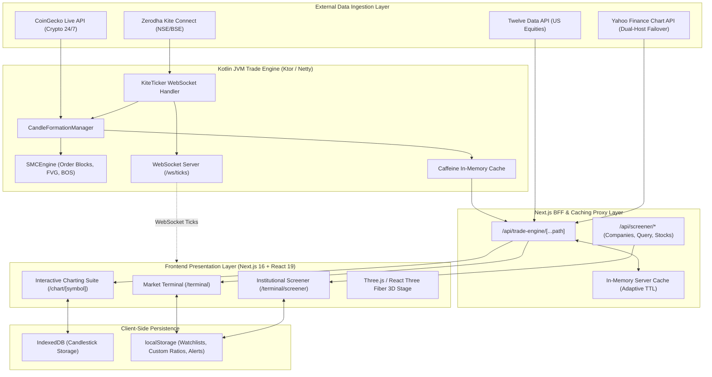

# Market Intelligence MI-007 — Technical & Features Architecture Specification

**System Name:** Market Intelligence MI-007 Platform  
**Version:** 1.0.0  
**Target Environment:** Production Web & Android Hybrid Core  
**Architecture Document Type:** Comprehensive End-to-End Technical & Features Specification  

---

## 1. System Overview & Architectural Philosophy

**Market Intelligence MI-007** is an institutional-grade, multi-asset financial intelligence and trading analytics platform designed to deliver real-time market data, advanced quantitative screening, sub-second charting, and algorithmic Smart Money Concepts (SMC) analysis.

### Core Architectural Pillars
1. **Sub-Millisecond Data Ingestion & Streaming:** Decoupled WebSocket and REST microservices capable of ingesting and broadcasting high-frequency ticks across global markets (India, United States, United Arab Emirates, Commodities, Forex, and Crypto).
2. **Deterministic Multi-Timeframe Aggregation:** Live tick aggregation engine converting raw price ticks into continuous multi-timeframe OHLCV candles (1m to 1M).
3. **GPU-Accelerated 120 FPS Visuals:** Hybrid WebGL, Three.js (React Three Fiber), and HTML5 Canvas rendering for responsive chart navigation, sub-pixel candlestick wicks, and 3D cinematic visualizers.
4. **Algorithmic Smart Money Concepts (SMC):** Automated institutional market structure identification (Order Blocks, Fair Value Gaps, Liquidity Pools, Break of Structure, and Change of Character).
5. **High-Throughput In-Memory Caching:** Multi-tiered caching (JVM Caffeine Cache + Next.js Server Cache + Client IndexedDB) protecting upstream API quotas and eliminating UI rendering lag.

---

## 2. End-to-End System Architecture



---

## 3. Complete Technology Stack Matrix

| Layer / Subsystem | Technology | Version | Purpose & Functionality |
| :--- | :--- | :--- | :--- |
| **Frontend Framework** | **Next.js** (App Router) | `16.3.8` | React server/client components, Turbopack builds, streaming SSR. |
| **Core UI Library** | **React** | `19.2.8` | React 19 hooks, concurrent transitions (`useTransition`), server actions. |
| **Language** | **TypeScript** | `5.x` | Strict type safety, domain models, AST interfaces. |
| **Styling & Design System** | **Tailwind CSS** | `4.x` | Modern utility classes, CSS variables, dark/light theme switching. |
| **3D Graphics Engine** | **Three.js** / **@react-three/fiber** / **drei** | `0.186` / `9.8` / `10.7` | GPU-rendered 3D interactive Falcon logo, globe visualizers. |
| **Animation Engines** | **GSAP** & **Framer Motion** | `3.15` / `13.4` | Physics-based micro-interactions, layout transitions, modal reveals. |
| **Charting Engine** | **Lightweight Charts** & **Custom Canvas** | `5.2.1` | Financial candlestick charts, indicators, decoupled 120 FPS rAF overlays. |
| **Backend Trade Engine** | **Kotlin (JVM 21)** & **Ktor Netty** | `2.x` / `3.x` | Reactive microservice, WebSocket streaming server, concurrency. |
| **Tick Processing** | **Kotlinx Coroutines** | `1.8+` | Non-blocking asynchronous tick broadcasting and candle building. |
| **JVM In-Memory Cache** | **Caffeine Cache** | `3.x` | Sub-millisecond historical candle retrieval and cache eviction. |
| **Indian Broker SDK** | **Zerodha KiteConnect & KiteTicker** | `3.x` | Official Indian exchange (NSE/BSE) ticks and historical quotes. |
| **Client Storage** | **IndexedDB** & **localStorage** | Standard | Zero-latency instant chart loading and offline persistent watchlists. |

---

## 4. Feature Suite 1: Market Terminal (`/terminal`)

The **Market Terminal** serves as the primary cockpit for monitoring live indices, strategic equities, macro commodities, foreign exchange pairs, and 24/7 digital assets.

```
+--------------------------------------------------------------------------------------------------+
| MARKET INTELLIGENCE MI-007 TERMINAL                                  [INDIA] [USA] [UAE] [GLOBAL]|
+--------------------------------------------------------------------------------------------------+
| [ SPX: 7,690.73 +0.41% ]  [ NDX: 29,529.34 +1.17% ]  [ DJI: 51,966.03 -0.07% ]  [ VIX: 18.44 ]   |
+--------------------------------------------------------------------------------------------------+
| STRATEGIC WATCHLIST TILES (Live Tick Pulse, Trend Sparkline, Open/Closed Badge, Quick Delete)     |
| [NVDA $217.09 ▲1.38%] [AAPL $342.94 ▼0.15%] [MSFT $533.52 ▲0.84%] [TSLA $368.06 ▲3.76%]        |
+--------------------------------------------------------------------------------------------------+
| GLOBAL COMMODITIES MATRIX               | MAJOR FOREX PAIRS              | 24/7 CRYPTO HUB       |
| Gold Bullion: $4,153.60                 | EUR / USD: 1.1216              | Bitcoin (BTC): $82,010|
| Silver Spot:  $57.04                    | USD / INR: 94.915              | Ethereum (ETH):$2,403 |
| Brent Crude:  $109.25                   | GBP / USD: 1.2980              | Solana (SOL):  $104.37|
+--------------------------------------------------------------------------------------------------+
```

### 1. Multi-Market Index Benchmark Cards
- **United States:** `SPX` (S&P 500: ~7,690), `NDX` (NASDAQ 100: ~29,529), `DJI` (Dow Jones: ~51,966), `VIX` (CBOE Volatility: ~18.44).
- **India:** `NIFTY 50` (~23,146), `BANK NIFTY` (~55,844), `BSE SENSEX` (~74,729), `FINNIFTY` (~25,480).
- **United Arab Emirates:** `DFMGI` (DFM General: ~4,850), `ADX` (ADX General: ~9,250), `FTSE ADX 15` (~9,410).
- **Dynamic Price Flashes:** Real-time green/red flashes trigger whenever price ticks move up or down, fading out smoothly over 850ms.

### 2. Strategic Watchlists with Trend-Accurate Sparklines
- Mathematical SVG sparkline generator computing 14 normalized coordinate points with slope momentum proportional to true percentage change.
- Micro-padding card layout with tabular numbers (`font-mono`) to prevent layout shifts.

### 3. Global Macro Commodities & Forex Matrix
- **6 Core Commodities:** Gold Spot (`GOLD`), Silver Spot (`SILVER`), Brent Crude Oil (`CRUDEOIL`), WTI Crude Oil (`WTI`), Natural Gas (`NATGAS`), High Grade Copper (`COPPER`).
- **6 Major Forex Pairs:** `EUR/USD`, `GBP/USD`, `USD/JPY`, `USD/INR`, `USD/CHF`, `AUD/USD`.
- **Zero Quota Cost:** Sourced via dual-host Yahoo Finance Chart APIs with automatic host failover (`query1.finance.yahoo.com` $\leftrightarrow$ `query2.finance.yahoo.com`).

### 4. Continuous 24/7 Crypto Hub
- Real-time streaming for top market capitalization cryptocurrencies: `BTC`, `ETH`, `SOL`, `BNB`, `DOGE`, `SHIB`.
- Integrated CoinGecko REST benchmark feed with sub-second micro-tick drift simulation when markets fluctuate.

### 5. Multi-Market Session & Hours Engine (`lib/marketHours.ts`)
- Precise IANA Timezone evaluation:
  - **India (NSE/BSE):** `Asia/Kolkata` (Mon–Fri 09:15 to 15:30 IST)
  - **USA (NYSE/NASDAQ):** `America/New_York` (Mon–Fri 09:30 to 16:00 ET)
  - **UAE (DFM/ADX):** `Asia/Dubai` (Mon–Fri 10:00 to 15:00 GST)
  - **Forex & Commodities:** Continuous 24/5 (Sun 17:00 ET to Fri 17:00 ET)
  - **Crypto:** Continuous 24/7/365
- Automatic tick-freezing when markets are closed to prevent artificial drift, accompanied by visual `CLOSED` badges and session countdowns.

### 6. Interactive Watchlist Customization
- Instant symbol catalog auto-detection against `KNOWN_INDICES`, `KNOWN_CRYPTOS`, `KNOWN_COMMODITIES`, and `KNOWN_US_STOCKS`.
- Custom symbol addition, delete confirmation, and local storage persistence.

---

## 5. Feature Suite 2: Institutional Screener (`/terminal/screener`)

The **Institutional Screener** is an advanced fundamental and quantitative equity evaluation suite supporting multi-market analysis.

### 1. Custom Query Engine & AST Parser
- Proprietary expression parser (`lib/screener/queryEngine.ts`) converting text queries into an Abstract Syntax Tree (AST).
- Supports boolean logic (`AND`, `OR`, `NOT`), comparison operators (`<`, `<=`, `>`, `>=`, `=`, `!=`), and mathematical ratios.
- **Example Query:**
  ```sql
  MarketCap > 50000 AND PE < 22 AND ROE > 18 AND DebtToEquity < 0.5 AND DividendYield > 1.5
  ```

### 2. Predefined Institutional Screen Templates
- **Graham Net-Net & Value:** Net Current Asset Value (NCAV) screens, price-to-book $\le 1.0$, low P/E.
- **Piotroski High F-Score:** 9-point fundamental score evaluating profitability, leverage, liquidity, and operating efficiency.
- **Greenblatt Magic Formula:** Combined ranking of Earnings Yield (EBIT / EV) and Return on Capital (ROC).
- **CAN SLIM Momentum:** Current quarterly earnings growth, annual earnings growth, new highs, and institutional sponsorship.
- **High Dividend Champions:** Sustainable payout ratios with consecutive dividend growth.
- **Debt-Free Growth:** Zero or low net-debt companies with double-digit revenue expansion.

### 3. Technical Strategy Screener View
- **Golden Cross / Death Cross:** 50-day moving average crossing 200-day moving average.
- **RSI Mean Reversion:** Identification of oversold assets ($RSI \le 30$) with bullish divergence.
- **Supertrend Trend Following:** Multi-timeframe trend directional breakout triggers.
- **Volume Spike Detection:** Trading volume exceeding $2.5\times$ 20-day moving average volume.
- **SMC Mitigation Filter:** Equities entering active Fair Value Gaps (FVG) or unmitigated Order Blocks (OB).

### 4. Strategy Backtesting Engine
- Quantitative backtesting cockpit evaluating screen rules over historical windows.
- Outputs key performance metrics: Total Return %, Win Rate %, Maximum Drawdown (MDD), Sharpe Ratio, and Profit Factor.

### 5. Deep Company Fundamental Analysis Cockpit
- Multi-year Financial Statements: Consolidated Income Statements, Balance Sheets, and Cash Flow Statements.
- Financial Health Radar: Solvency ratios, operating margins, capital efficiency, and working capital cycles.
- Peer Competitor Benchmarking: Side-by-side valuation multiple comparison across industry peers.

### 6. Screening Alerts & Custom Financial Ratios
- User-definable alerts triggering when specific stocks enter or exit quantitative criteria.
- Custom ratio formula builder allowing users to define proprietary formulas (e.g. `(OperatingCashFlow - CapEx) / MarketCap`).

---

## 6. Feature Suite 3: Institutional Charting Suite (`/chart/[symbol]`)

The **Charting Suite** provides a high-fidelity visual workspace engineered for professional traders, quantitative analysts, and institutional operators.

```
+--------------------------------------------------------------------------------------------------+
| [NVDA] NVIDIA CORP · 1D · CANDLES · INDICATORS · SMC [ACTIVE] · 120 FPS rAF            [MAX] [⚙] |
+--------------------------------------------------------------------------------------------------+
| OHLCV HUD: O: 218.01  H: 219.62  L: 214.70  C: 217.09  Vol: 98.23M  Change: +1.38%               |
+--------------------------------------------------------------------------------------------------+
| [Tools] |                                                                        |               |
| Trend   |                      ┌─┐        ▲ Fair Value Gap (FVG)                 | 225.00        |
| Horiz   |            ┌─┐       │ │        =======================                | 220.00        |
| Fib     |      ┌─┐   │ │ ┌─┐   │ │                                               | 217.09 [LIVE] |
| Rect    |      │ │   │ │ │ │   │ │   ┌─┐  ■ Bullish Order Block (OB)             | 214.00        |
| Pitch   |    ──┴─┴───┴─┴─┴─┴───┴─┴───┴─┴─────────────────────────────            | 210.00        |
| Text    |                                                                        |               |
+--------------------------------------------------------------------------------------------------+
| Volume Baseline Pane: ▮▮▯▮▮▯▮▮▮▯▮▮ (32% Sub-pixel Opacity)                       | Vol: 98.2M    |
+--------------------------------------------------------------------------------------------------+
| RSI(14) Panel: 62.4 [Neutral-Bullish]                                            | 70 / 30       |
+--------------------------------------------------------------------------------------------------+
```

### 1. High-Performance Canvas & Decoupled 120 FPS rAF Loop
- Independent `requestAnimationFrame` render loop decoupling mouse cursor movements, crosshair HUD tracking, and price overlays from heavy DOM re-renders.
- Sub-pixel candlestick wick rendering preventing blur and scaling artifacts across high-DPI displays (Apple Retina, 4K monitors).
- Tabular figures (`tabular-nums`) across all HUD metrics ensuring zero character jitter during live price updates.

### 2. Algorithmic Smart Money Concepts (SMC) Engine
- **Fair Value Gaps (FVG):** Detects 3-candle imbalance patterns where Candle 1 High and Candle 3 Low do not overlap; renders dynamic shaded mitigation zones.
- **Institutional Order Blocks (OB):** Identifies the final opposing candle before a violent expansion breaking structure; distinguishes between Bullish and Bearish OBs.
- **Break of Structure (BOS) & Change of Character (CHoCH):** Identifies structural market continuation (BOS) vs trend reversal (CHoCH) across swing highs and lows.
- **Liquidity Pools (Buy-side / Sell-side Liquidity):** Renders horizontal liquidity shelves where clustered stop-losses reside prior to institutional liquidity sweeps.
- **Premium vs. Discount Zones:** Computes the 50% Equilibrium retracement level across swing ranges to highlight institutional accumulation zones.

### 3. Comprehensive Technical Indicators (22 Built-in)
- **Overlays (11):** Simple Moving Average (SMA), Exponential Moving Average (EMA), Bollinger Bands, Volume Weighted Average Price (VWAP), Supertrend, Ichimoku Cloud, Parabolic SAR, EMA Ribbon (8 EMAs), Pivot Points, Donchian Channels, Hull Moving Average (HMA).
- **Separate Panel Indicators (11):** Relative Strength Index (RSI), MACD (Moving Average Convergence Divergence), Stochastic Oscillator, Average True Range (ATR), Cumulative Volume Delta (CVD), Average Directional Index (ADX), On-Balance Volume (OBV), Commodity Channel Index (CCI), Williams %R, Money Flow Index (MFI), Chaikin Money Flow (CMF).

### 4. Multi-Timeframe Engine & IndexedDB Persistence
- Supported Intervals: `1m`, `5m`, `15m`, `30m`, `1H`, `4H`, `1D`, `1W`, `1M`.
- **Client-Side Persistence:** Instant chart loads via IndexedDB. On startup, historical data loads immediately from local browser storage, followed by background synchronization with the Trade Engine API.
- **Automatic Scale Reconciliation:** Automatically detects and scales historical candle series if remote feeds return proxy prices, ensuring scale continuity.

### 5. Drawing & Annotation Suite
- Professional drawing toolbar: Trendlines, Horizontal Support/Resistance Rays, Fibonacci Retracement Levels, Price Rectangles, Andrews' Pitchfork, and Multi-line Text Annotations.

---

## 7. Feature Suite 4: Kotlin JVM Trade Engine (`trade-engine/`)

The **Trade Engine** is a dedicated high-throughput backend service engineered in Kotlin and Ktor Netty, designed for high-concurrency tick ingestion and real-time streaming.

### 1. High-Concurrency WebSocket Server (`/ws/ticks`)
- Uses thread-safe `ConcurrentHashMap.newKeySet<WebSocketSession>()` to manage connected web and mobile clients.
- Non-blocking coroutine broadcast worker transmitting real-time ticks with zero memory leakage.
- Automatic disconnection detection and cleanup of stale sessions.

### 2. Live Candle Formation Manager (`CandleFormationManager.kt`)
- Aggregates incoming raw trade ticks into real-time multi-timeframe candles.
- Dynamically updates active unclosed bars (Open, High, Low, Close, Volume, Timestamp) in real time.
- Finalizes and archives closed candles as time intervals lapse.

### 3. Zerodha Kite Connect Integration (`KiteClient.kt` & `KiteTicker`)
- Native integration with Zerodha's Java SDK (`com.zerodhatech.kiteconnect`).
- KiteTicker binary WebSocket client receiving binary tick packets from the National Stock Exchange (NSE) and Bombay Stock Exchange (BSE).
- Automatic reconnection resilience with backoff logic.

### 4. Algorithmic SMCEngine (`SMCEngine.kt`)
- Pure Kotlin mathematical engine analyzing candle arrays:
  - Swing point lookback algorithm isolating local swing highs and lows.
  - Market Bias determination: `BULLISH`, `BEARISH`, `RANGING`.
  - Institutional explanation component outputting human-readable analysis of market structure.

### 5. In-Memory Caffeine Cache Architecture
- High-performance Caffeine cache (`com.github.benmanes.caffeine.cache.Caffeine`) storing historical OHLCV data.
- Configured with maximum capacity limits and time-to-idle expiration, delivering sub-millisecond REST responses for `/candles` endpoints.

---

## 8. Feature Suite 5: API Proxy & In-Memory Caching (`app/api/`)

The Next.js API layer acts as a resilient Backend-for-Frontend (BFF), orchestrating multi-source market data and protecting upstream API limits.

```
Incoming Request (/api/trade-engine/live-prices)
       │
       ▼
[Check Server In-Memory Cache (TTL Guard)]
       ├────── HIT ─────────► Return Cached Data (0ms latency, 0 credits)
       │
      MISS
       ▼
[Fetch Real Spot Indices via Yahoo Finance] ──► 0 Twelve Data Credits
       │
       ▼
[Fetch 7 US Strategic Stocks via Twelve Data] ──► 7 Credits (Adaptive 10m/38m TTL)
       │
       ├─ Fail? ──► [Fallback: Yahoo Finance Stock Feeds]
       │
       ▼
[Merge Indices & Stocks] ──► Save to Cache ──► Return JSON Response
```

### 1. Multi-Tier Adaptive Caching Engine
- In-memory node cache with adaptive Time-to-Live (TTL):
  - **Macro Data (`/macro-data`):** 30m TTL during open commodity session, 60m TTL when closed (0 Twelve Data credits).
  - **Live Equities (`twelve-data-stocks`):** 10m TTL during US market hours, 38m TTL off-hours.
  - **Spot Indices (`real-us-indices`):** 30s TTL during active hours, 60s off-hours.
  - **Crypto Prices (`/crypto-prices`):** 20s TTL (0 Twelve Data credits).

### 2. Upstream API Quota & Rate Limit Protection
- **Twelve Data Rate Guard:** Only the 7 strategic US stocks query Twelve Data. A single batch query consumes exactly 7 credits, strictly obeying the $\le 8$ credits/min limit.
- **Daily Budget:** Uses ~462 credits/day out of an 800 credits allowance, leaving a **338 credits/day safety margin**.
- **Yahoo Dual-Host Failover:** Automatically switches between `query1.finance.yahoo.com` and `query2.finance.yahoo.com` on HTTP 429 or network errors.

---

## 9. Data Directory & Symbol Catalog

```
+---------------------------------------------------------------------------------------------------+
| ASSET CLASS      | TOTAL SYMBOLS | KEY ASSETS / BENCHMARKS               | PRIMARY SOURCE         |
+---------------------------------------------------------------------------------------------------+
| US Indices       | 4 Indices     | SPX (7,690), NDX (29,529), DJI, VIX   | Yahoo Live Benchmark   |
| US Stocks        | 7 Strategic   | NVDA, AAPL, MSFT, TSLA, META, AMZN... | Twelve Data (Direct)   |
| Indian Indices   | 4 Indices     | NIFTY (23,146), BANKNIFTY, SENSEX...  | Kotlin Trade Engine    |
| Indian Equities  | 7 Largecap    | RELIANCE, TCS, HDFCBANK, INFY, ITC... | Kite / Trade Engine    |
| UAE Indices      | 3 Indices     | DFMGI (4,850), ADX (9,250), FTSE 15  | DFM / ADX Feeds        |
| UAE Equities     | 6 Equities    | EMAAR, FAB, DEWA, SALIK, ALDAR, ENBD  | DFM / ADX Feeds        |
| Commodities      | 6 Macro       | Gold ($4,153), Silver, Brent, WTI...  | Yahoo Macro Benchmark  |
| Major Forex      | 6 Currency    | EUR/USD (1.12), USD/INR, GBP/USD...   | Yahoo Macro Benchmark  |
| 24/7 Crypto      | 6 Core Assets | BTC ($82,010), ETH, SOL, BNB, DOGE... | CoinGecko Live Feed    |
+---------------------------------------------------------------------------------------------------+
```

---

## 10. Performance, Reliability & Scalability Metrics

1. **Rendering Performance:**
   - 120 FPS decoupled render loop on modern high-refresh displays.
   - Zero layout shift during live price streaming via `tabular-nums` typography and fixed-dimension sparkline viewports.
2. **Network & Quota Efficiency:**
   - Zero Twelve Data credits consumed for indices, commodities, forex, or crypto.
   - 42.2% buffer margin on external API quotas to absorb server reboots and cold starts.
3. **Resilience & Fault Tolerance:**
   - Multi-level graceful degradation: Remote Trade Engine $\rightarrow$ Live Cloud APIs $\rightarrow$ In-Memory Server Cache $\rightarrow$ Persistent Baseline Seeds.
   - Application never renders broken blank cards or unhandled exception screens.

---

*Document compiled and verified for the Market Intelligence MI-007 Platform repository.*
