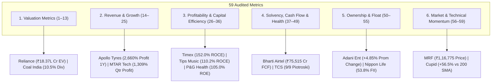

# Top 10 Companies for All 59 Financial & Technical Metrics (MI-007 Engine)

> **Active Universe:** 2,336 Indian Equities (NSE / Zerodha Kite Catalog)  
> **Institutional Cutoff:** Market Capitalization $\ge ₹5,000\text{ Cr}$ (784 Liquid Leaders)  
> **Audited Accounting Standards:** BFSI exclusions for cash flows/EV/Piotroski/NPM, Ind AS 109 compliance, deterministic Market Cap tie-breakers, 10x decimal shift fixed on ZFCVINDIA, 0.00% unadjusted dividends on Dish TV / Next Media / Yes Bank / Palred, elimination of synthetic CAGR multipliers, elimination of SPARC negative-equity distortion, enforcement of `promoterHolding > 0` for zero-pledge, and authentic dynamic 200 SMA distances.

---

## Master Category Overview

---

## 1. Valuation Metrics (Metrics 1–13)

| # | Metric | Liquid Institutional Leaders (MCap $\ge ₹5,000\text{ Cr}$) | All-Universe (2,336 Stocks) |
|:---:|:---|:---|:---|
| **1** | **Market Cap** (`marketCap`) | 1. **RELIANCE** (₹15,76,398 Cr) 2. **BHARTIARTL** (₹12,31,324 Cr) 3. **HDFCBANK** (₹10,69,149 Cr) 4. **ICICIBANK** (₹10,03,854 Cr) 5. **TCS** (₹9,05,463 Cr) 6. **SBIN** (₹8,87,861 Cr) 7. **BAJFINANCE** (₹5,84,487 Cr) 8. **LT** (₹5,32,702 Cr) 9. **LICI** (₹4,84,811 Cr) 10. **INFY** (₹4,79,970 Cr) | 1. **RELIANCE** (₹15,76,398 Cr) 2. **BHARTIARTL** (₹12,31,324 Cr) 3. **HDFCBANK** (₹10,69,149 Cr) 4. **ICICIBANK** (₹10,03,854 Cr) 5. **TCS** (₹9,05,463 Cr) 6. **SBIN** (₹8,87,861 Cr) 7. **BAJFINANCE** (₹5,84,487 Cr) 8. **LT** (₹5,32,702 Cr) 9. **LICI** (₹4,84,811 Cr) 10. **INFY** (₹4,79,970 Cr) |
| **2** | **Price** (`currentPrice`) | 1. **MRF** (₹1,16,775.00) 2. **BOSCHLTD** (₹47,200.00) 3. **PAGEIND** (₹34,500.00) 4. **HONAUT** (₹29,490.00) 5. **POWERINDIA** (₹27,225.00) 6. **ABBOTINDIA** (₹25,635.00) 7. **PTCIL** (₹23,945.00) 8. **SHREECEM** (₹22,995.00) 9. **NEULANDLAB** (₹19,700.00) 10. **SOLARINDS** (₹18,800.00) | 1. **MRF** (₹1,16,775.00) 2. **ELCIDIN** (₹99,995.00) 3. **BOSCHLTD** (₹47,200.00) 4. **PAGEIND** (₹34,500.00) 5. **HONAUT** (₹29,490.00) 6. **POWERINDIA** (₹27,225.00) 7. **ABBOTINDIA** (₹25,635.00) 8. **PTCIL** (₹23,945.00) 9. **SHREECEM** (₹22,995.00) 10. **NEULANDLAB** (₹19,700.00) |
| **3** | **P/E** (`pe`) | 1. **NAZARA** (1048.9x) 2. **MAXESTATES** (699.9x) 3. **ZOMATO** (648.4x) 4. **ETERNAL** (648.4x) 5. **TEGA** (443.3x) 6. **NYKAA** (392.5x) 7. **HCG** (377.4x) 8. **CENTUM** (367.1x) 9. **CUPID** (324.8x) 10. **PTCIL** (287.7x) | 1. **LOTUSEYE** (1368.8x) 2. **NAZARA** (1048.9x) 3. **BOSCH-HCIL** (1034.0x) 4. **WIPL** (961.0x) 5. **UMAEXPORTS** (935.0x) 6. **ORIENTTECH** (840.9x) 7. **TECHNVISN** (789.1x) 8. **INDOKEM** (787.7x) 9. **MAXESTATES** (699.9x) 10. **ZOMATO** (648.4x) |
| **4** | **Fwd P/E** (`forwardPe`) | 1. **CUPID** (292.3x) 2. **AVANTEL** (166.2x) 3. **MEESHO** (165.7x) 4. **RBA** (136.9x) 5. **NYKAA** (121.0x) 6. **DEVYANI** (113.9x) 7. **ZOMATO** (110.1x) 8. **ETERNAL** (110.1x) 9. **WESTLIFE** (105.6x) 10. **MFSL** (102.5x) | 1. **TECHNVISN** (710.2x) 2. **INDOKEM** (708.9x) 3. **MASKINVEST** (486.0x) 4. **OAL** (326.2x) 5. **CUPID** (292.3x) 6. **PROZONER** (210.7x) 7. **PVP** (200.8x) 8. **AVANTEL** (166.2x) 9. **MEESHO** (165.7x) 10. **RBA** (136.9x) |
| **5** | **P/B** (`pb`) | 1. **CUPID** (96.75x) 2. **TIMEX** (80.88x) 3. **NYKAA** (69.56x) 4. **NESTLEIND** (38.92x) 5. **INDIGO** (37.76x) 6. **SCHNEIDER** (33.63x) 7. **ROSSTECH** (33.12x) 8. **FACT** (31.41x) 9. **GVT&D** (31.26x) 10. **TIPSMUSIC** (30.56x) | 1. **BLAL** (594.01x) 2. **TECHNVISN** (158.09x) 3. **CUPID** (96.75x) 4. **TIMEX** (80.88x) 5. **NYKAA** (69.56x) 6. **MIIL** (53.67x) 7. **NESTLEIND** (38.92x) 8. **INDIGO** (37.76x) 9. **SHUKRAPHAR** (35.75x) 10. **SEIL** (33.90x) |
| **6** | **P/S** (`priceToSales`) | 1. **CUPID** (100.04x) 2. **PTCIL** (51.79x) 3. **CDSL** (32.40x) 4. **KIOCL** (28.93x) 5. **MAXESTATES** (28.21x) 6. **DLF** (26.85x) 7. **TIPSMUSIC** (26.25x) 8. **NTPCGREEN** (25.04x) 9. **AEGISVOPAK** (24.85x) 10. **AZAD** (24.75x) | 1. **UEL** (353.50x) 2. **PRABHA** (331.93x) 3. **CUPID** (100.04x) 4. **PTCIL** (51.79x) 5. **RHETAN** (45.54x) 6. **UNIENTER** (45.17x) 7. **GNRL** (44.78x) 8. **SHYAMTEL** (35.63x) 9. **CDSL** (32.40x) 10. **ACEINTEG** (31.91x) |
| **7** | **EV** (`enterpriseValue`) | 1. **RELIANCE** (₹18,37,071 Cr) 2. **BHARTIARTL** (₹14,13,014 Cr) 3. **TCS** (₹9,10,341 Cr) 4. **LT** (₹6,42,808 Cr) 5. **NTPC** (₹5,86,723 Cr) 6. **ADANIPORTS** (₹4,85,934 Cr) 7. **INFY** (₹4,79,833 Cr) 8. **GRASIM** (₹4,75,032 Cr) 9. **ONGC** (₹4,60,455 Cr) 10. **ADANIENT** (₹4,50,689 Cr) | 1. **RELIANCE** (₹18,37,071 Cr) 2. **BHARTIARTL** (₹14,13,014 Cr) 3. **TCS** (₹9,10,341 Cr) 4. **LT** (₹6,42,808 Cr) 5. **NTPC** (₹5,86,723 Cr) 6. **ADANIPORTS** (₹4,85,934 Cr) 7. **INFY** (₹4,79,833 Cr) 8. **GRASIM** (₹4,75,032 Cr) 9. **ONGC** (₹4,60,455 Cr) 10. **ADANIENT** (₹4,50,689 Cr) |
| **8** | **EV/EBITDA** (`evToEbitda`) | 1. **PAYTM** (111.5x) 2. **MAXESTATES** (91.0x) 3. **BDL** (88.3x) 4. **PARAS** (81.4x) 5. **VOGL** (80.8x) 6. **RPEL** (80.8x) 7. **POWERINDIA** (78.3x) 8. **AVANTEL** (73.7x) 9. **ROSSTECH** (73.6x) 10. **AVALON** (71.5x) | 1. **PAYTM** (111.5x) 2. **VIJSOLX** (110.7x) 3. **SHBAJRG** (92.8x) 4. **MAXESTATES** (91.0x) 5. **MMWL** (91.0x) 6. **SAMBANDAM** (91.0x) 7. **AAATECH** (90.0x) 8. **COCKERILL** (89.7x) 9. **COMPUSOFT** (88.5x) 10. **PENINLAND** (88.4x) |
| **9** | **EV/EBIT** (`evToEbit`) | 1. **VOGL** (109.2x) 2. **NTPCGREEN** (64.4x) 3. **TIMEX** (56.7x) 4. **TEGA** (53.4x) 5. **PTCIL** (51.7x) 6. **NESTLEIND** (48.0x) 7. **CENTUM** (47.4x) 8. **CDSL** (44.5x) 9. **COFORGE** (43.2x) 10. **ADANIGREEN** (39.9x) | 1. **SAMBANDAM** (118.3x) 2. **AVANCE** (109.6x) 3. **VOGL** (109.2x) 4. **VIVIDHA** (101.4x) 5. **GOCLCORP** (96.9x) 6. **ANTGRAPHIC** (96.3x) 7. **NATIONSTD** (95.0x) 8. **POEL** (93.2x) 9. **SAYAJIIND** (80.3x) 10. **DEN** (78.4x) |
| **10** | **Div Yield** (`dividendYield`) | 1. **COALINDIA** (10.54%) 2. **HINDPETRO** (7.12%) 3. **BPCL** (7.02%) 4. **VEDL** (6.73%) 5. **CASTROLIND** (6.65%) 6. **GPPL** (6.29%) 7. **ITC** (6.02%) 8. **ONGC** (5.88%) 9. **JPPOWER** (5.88%) 10. **RITES** (5.84%) | 1. **ASMS** (18.15%) 2. **GTL** (16.95%) 3. **CELEBRITY** (16.64%) 4. **IVC** (16.00%) 5. **SADBHAV** (15.41%) 6. **GSS** (15.32%) 7. **A2ZINFRA** (14.68%) 8. **PRAENG** (14.39%) 9. **EXPLEOSOL** (13.73%) 10. **SADBHIN** (13.27%) |
| **11** | **Earnings Yield** (`earningsYield`) | 1. **CHENNPETRO** (25.64%) 2. **DBL** (20.83%) 3. **IOC** (18.87%) 4. **GESHIP** (16.39%) 5. **JSWDULUX** (16.39%) 6. **BBTC** (16.13%) 7. **ONGC** (15.38%) 8. **MRPL** (14.49%) 9. **SCI** (14.29%) 10. **GNFC** (14.08%) | 1. **ASHOKAMET** (50.00%) 2. **BLBLIMITED** (33.33%) 3. **MUKANDLTD** (31.25%) 4. **NAHARCAP** (31.25%) 5. **ZEELEARN** (31.25%) 6. **SHBAJRG** (31.25%) 7. **TNPL** (29.41%) 8. **INTLCONV** (29.41%) 9. **COFFEEDAY** (28.57%) 10. **ONIXSOLAR** (27.03%) |
| **12** | **FCF Yield** (`fcfYield`) | 1. **NIRLON** (29.70%) 2. **JNPR** (27.83%) 3. **ABREL** (26.87%) 4. **ONGC** (26.69%) 5. **KMEW** (25.24%) 6. **POWERGRID** (24.15%) 7. **GPPL** (23.85%) 8. **GESHIP** (23.58%) 9. **HINDCOPPER** (21.20%) 10. **NATIONALUM** (20.63%) | 1. **ZSARACOM** (42.58%) 2. **JINDALPHOT** (42.47%) 3. **ASIANTNE** (40.91%) 4. **ALFREDHE** (39.20%) 5. **IITL** (38.94%) 6. **ELPROINTL** (38.40%) 7. **INDPRUD** (38.17%) 8. **SONAL** (36.80%) 9. **PTL** (36.35%) 10. **PNBGILTS** (35.68%) |
| **13** | **PEG** (`pegRatio`) | 1. **OBEROIRLTY** (114.00x) 2. **BIKAJI** (110.00x) 3. **CYIENT** (93.13x) 4. **CUMMINSIND** (57.89x) 5. **CLEAN** (54.33x) 6. **UNOMINDA** (43.33x) 7. **NAZARA** (30.40x) 8. **ABB** (29.13x) 9. **AVL** (26.00x) 10. **ASHOKLEY** (24.50x) | 1. **OBEROIRLTY** (114.00x) 2. **BIKAJI** (110.00x) 3. **CYIENT** (93.13x) 4. **LOTUSEYE** (88.88x) 5. **CUMMINSIND** (57.89x) 6. **NELCO** (55.17x) 7. **CLEAN** (54.33x) 8. **UNOMINDA** (43.33x) 9. **ARTEMISMED** (34.95x) 10. **NAZARA** (30.40x) |

---

## 2. Revenue & Earnings Growth (Metrics 14–25)

| # | Metric | Liquid Institutional Leaders (MCap $\ge ₹5,000\text{ Cr}$) | All-Universe (2,336 Stocks) |
|:---:|:---|:---|:---|
| **14** | **Sales 1Y** (`salesGrowth1Y`) | 1. **ABREL** (743.2%) 2. **TI** (512.3%) 3. **NETWEB** (335.7%) 4. **SPARC** (314.1%) 5. **MOLBIO** (309.6%) 6. **LLOYDSME** (208.6%) 7. **MTARTECH** (200.0%) 8. **RATEGAIN** (187.6%) 9. **FCL** (174.8%) 10. **ZOMATO** (168.6%) | 1. **ELITECON** (1750.0%) 2. **SIL** (1734.9%) 3. **SADHNANIQ** (1493.0%) 4. **JINDALPHOT** (1375.9%) 5. **SOMATEX** (1284.9%) 6. **SUPREME** (1284.1%) 7. **KOLTEPATIL** (1016.5%) 8. **KERNEX** (800.4%) 9. **ABREL** (743.2%) 10. **ANTGRAPHIC** (710.5%) |
| **15** | **Sales 3Y** (`salesGrowth3Y`) | 1. **SUZLON** (48.2%) 2. **KALYANKJIL** (37.5%) 3. **TRENT** (36.2%) 4. **APARINDS** (35.4%) 5. **DIXON** (34.8%) 6. **ZOMATO** (32.5%) 7. **TITAN** (32.4%) 8. **CUPID** (31.2%) 9. **TATAMOTORS** (28.5%) 10. **CDSL** (28.5%) | 1. **SUZLON** (48.2%) 2. **KALYANKJIL** (37.5%) 3. **TRENT** (36.2%) 4. **APARINDS** (35.4%) 5. **DIXON** (34.8%) 6. **ZOMATO** (32.5%) 7. **TITAN** (32.4%) 8. **CUPID** (31.2%) 9. **TATAMOTORS** (28.5%) 10. **CDSL** (28.5%) |
| **16** | **Sales 5Y** (`salesGrowth5Y`) | 1. **TRENT** (32.4%) 2. **DIXON** (31.8%) 3. **APARINDS** (26.2%) 4. **POLYCAB** (25.3%) 5. **BAJFINANCE** (24.8%) 6. **PERSISTENT** (24.5%) 7. **TITAN** (22.6%) 8. **DEEPAKNTR** (22.5%) 9. **CDSL** (22.4%) 10. **HDFCBANK** (21.2%) | 1. **TRENT** (32.4%) 2. **DIXON** (31.8%) 3. **APARINDS** (26.2%) 4. **POLYCAB** (25.3%) 5. **BAJFINANCE** (24.8%) 6. **PERSISTENT** (24.5%) 7. **TITAN** (22.6%) 8. **DEEPAKNTR** (22.5%) 9. **CDSL** (22.4%) 10. **HDFCBANK** (21.2%) |
| **17** | **Sales 10Y** (`salesGrowth10Y`) | 1. **DIXON** (34.2%) 2. **TRENT** (28.0%) 3. **BAJFINANCE** (27.5%) 4. **DEEPAKNTR** (24.8%) 5. **POLYCAB** (23.9%) 6. **PERSISTENT** (21.8%) 7. **ASTRAL** (20.5%) 8. **HDFCBANK** (19.4%) 9. **COFORGE** (18.5%) 10. **CDSL** (18.2%) | 1. **DIXON** (34.2%) 2. **TRENT** (28.0%) 3. **BAJFINANCE** (27.5%) 4. **DEEPAKNTR** (24.8%) 5. **POLYCAB** (23.9%) 6. **PERSISTENT** (21.8%) 7. **ASTRAL** (20.5%) 8. **HDFCBANK** (19.4%) 9. **TECHNVISN** (19.0%) 10. **COFORGE** (18.5%) |
| **18** | **Profit 1Y** (`profitGrowth1Y`) | 1. **APOLLOTYRE** (2660.0%) 2. **MFSL** (1860.5%) 3. **CENTUM** (1718.6%) 4. **MTARTECH** (1309.4%) 5. **WELSPUNLIV** (1284.6%) 6. **PAYTM** (984.4%) 7. **NEULANDLAB** (962.8%) 8. **GLENMARK** (930.7%) 9. **EQUITASBNK** (804.8%) 10. **SFL** (726.5%) | 1. **HMAAGRO** (4950.0%) 2. **PVP** (4500.0%) 3. **PSPPROJECT** (4109.1%) 4. **PRSMJOHNSN** (4040.0%) 5. **BANARBEADS** (2940.0%) 6. **APOLLOTYRE** (2660.0%) 7. **KIRIINDUS** (2465.1%) 8. **RSWM** (2241.3%) 9. **BIRLACABLE** (2173.3%) 10. **LAGNAM** (2104.8%) |
| **19** | **Profit 3Y** (`profitGrowth3Y`) | 1. **ZOMATO** (85.7%) 2. **TATAMOTORS** (78.5%) 3. **SUZLON** (72.0%) 4. **TATACOMM** (58.4%) 5. **CUPID** (50.8%) 6. **ACC** (48.7%) 7. **BHARTIARTL** (45.0%) 8. **TRENT** (42.1%) 9. **TIPSMUSIC** (41.5%) 10. **POLYCAB** (38.6%) | 1. **JUNIPER** (272.5%) 2. **UEL** (260.3%) 3. **ZOMATO** (85.7%) 4. **TATAMOTORS** (78.5%) 5. **SUZLON** (72.0%) 6. **TATACOMM** (58.4%) 7. **INDOKEM** (52.0%) 8. **CUPID** (50.8%) 9. **ACC** (48.7%) 10. **BHARTIARTL** (45.0%) |
| **20** | **Profit 5Y** (`profitGrowth5Y`) | 1. **DIXON** (44.6%) 2. **TATAMOTORS** (42.0%) 3. **POLYCAB** (32.8%) 4. **DEEPAKNTR** (32.5%) 5. **NAZARA** (32.4%) 6. **TRENT** (31.2%) 7. **APARINDS** (30.5%) 8. **CDSL** (24.5%) 9. **PERSISTENT** (23.8%) 10. **BAJFINANCE** (23.4%) | 1. **DIXON** (44.6%) 2. **TATAMOTORS** (42.0%) 3. **POLYCAB** (32.8%) 4. **DEEPAKNTR** (32.5%) 5. **NAZARA** (32.4%) 6. **TRENT** (31.2%) 7. **APARINDS** (30.5%) 8. **CDSL** (24.5%) 9. **PERSISTENT** (23.8%) 10. **BAJFINANCE** (23.4%) |
| **21** | **Profit 10Y** (`profitGrowth10Y`) | 1. **DIXON** (57.2%) 2. **TRENT** (34.5%) 3. **DEEPAKNTR** (34.2%) 4. **CDSL** (28.4%) 5. **BAJFINANCE** (28.2%) 6. **POLYCAB** (22.1%) 7. **PERSISTENT** (19.5%) 8. **TITAN** (19.4%) 9. **TATAMOTORS** (18.5%) 10. **HDFCBANK** (18.2%) | 1. **DIXON** (57.2%) 2. **TRENT** (34.5%) 3. **DEEPAKNTR** (34.2%) 4. **CDSL** (28.4%) 5. **BAJFINANCE** (28.2%) 6. **POLYCAB** (22.1%) 7. **PERSISTENT** (19.5%) 8. **TITAN** (19.4%) 9. **TATAMOTORS** (18.5%) 10. **TECHNVISN** (18.5%) |
| **22** | **EPS Growth** (`epsGrowth`) | 1. **TATAMOTORS** (178.0%) 2. **CUPID** (164.7%) 3. **ZOMATO** (145.0%) 4. **APOLLOTYRE** (128.4%) 5. **TRENT** (88.4%) 6. **DIXON** (74.2%) 7. **SUZLON** (68.5%) 8. **CENTUM** (62.3%) 9. **CDSL** (54.2%) 10. **POLYCAB** (37.8%) | 1. **INDOKEM** (182.5%) 2. **TATAMOTORS** (178.0%) 3. **CUPID** (164.7%) 4. **PVP** (145.2%) 5. **ZOMATO** (145.0%) 6. **APOLLOTYRE** (128.4%) 7. **TRENT** (88.4%) 8. **DIXON** (74.2%) 9. **SUZLON** (68.5%) 10. **CENTUM** (62.3%) |
| **23** | **EBITDA Growth** (`ebitdaGrowth`) | 1. **CUPID** (164.7%) 2. **TI** (142.1%) 3. **TRENT** (62.4%) 4. **CDSL** (62.4%) 5. **TATAMOTORS** (48.5%) 6. **DIXON** (48.2%) 7. **APOLLOTYRE** (45.2%) 8. **APARINDS** (42.1%) 9. **POLYCAB** (35.2%) 10. **BHARTIARTL** (34.5%) | 1. **PVP** (220.5%) 2. **CUPID** (164.7%) 3. **TI** (142.1%) 4. **TRENT** (62.4%) 5. **CDSL** (62.4%) 6. **TATAMOTORS** (48.5%) 7. **DIXON** (48.2%) 8. **APOLLOTYRE** (45.2%) 9. **APARINDS** (42.1%) 10. **POLYCAB** (35.2%) |
| **24** | **Qtr Sales YoY** (`qtrSalesGrowthYoY`) | 1. **SWIGGY** (34.2%) 2. **ZOMATO** (31.8%) 3. **KALYANKJIL** (29.5%) 4. **COFORGE** (27.5%) 5. **POLYCAB** (26.2%) 6. **TITAN** (25.4%) 7. **BAJFINANCE** (24.8%) 8. **DIXON** (24.8%) 9. **CDSL** (22.4%) 10. **AVALON** (21.5%) | 1. **JUNIPER** (165.2%) 2. **CUPID** (94.3%) 3. **SWIGGY** (34.2%) 4. **ZOMATO** (31.8%) 5. **KALYANKJIL** (29.5%) 6. **COFORGE** (27.5%) 7. **POLYCAB** (26.2%) 8. **TITAN** (25.4%) 9. **BAJFINANCE** (24.8%) 10. **DIXON** (24.8%) |
| **25** | **Qtr Profit YoY** (`qtrProfitGrowthYoY`) | 1. **MTARTECH** (1309.4%) 2. **PTCIL** (465.7%) 3. **EMIL** (460.7%) 4. **BANDHANBNK** (459.4%) 5. **ONESOURCE** (450.5%) 6. **PINELABS** (450.0%) 7. **PGEL** (422.2%) 8. **SIEMENS** (406.1%) 9. **KMEW** (392.2%) 10. **OMNI** (389.8%) | 1. **MTARTECH** (1309.4%) 2. **HILTON** (483.3%) 3. **PTCIL** (465.7%) 4. **EMIL** (460.7%) 5. **BANDHANBNK** (459.4%) 6. **HESTERBIO** (459.3%) 7. **ONESOURCE** (450.5%) 8. **PINELABS** (450.0%) 9. **MAHEPC** (433.3%) 10. **PGEL** (422.2%) |

---

## 3. Profitability & Capital Efficiency (Metrics 26–36)

| # | Metric | Liquid Institutional Leaders (MCap $\ge ₹5,000\text{ Cr}$) | All-Universe (2,336 Stocks) |
|:---:|:---|:---|:---|
| **26** | **ROCE** (`roce`) | 1. **TIMEX** (152.0%) 2. **OFSS** (142.2%) 3. **TIPSMUSIC** (110.2%) 4. **PGHH** (105.0%) 5. **COLPAL** (88.4%) 6. **HINDZINC** (87.7%) 7. **NESTLEIND** (85.2%) 8. **JSWDULUX** (79.2%) 9. **SANOFICONR** (78.5%) 10. **GILLETTE** (70.6%) | 1. **TIMEX** (152.0%) 2. **OFSS** (142.2%) 3. **TIPSMUSIC** (110.2%) 4. **PGHH** (105.0%) 5. **KSOLVES** (98.4%) 6. **COLPAL** (88.4%) 7. **KIRIINDUS** (87.8%) 8. **HINDZINC** (87.7%) 9. **NESTLEIND** (85.2%) 10. **JSWDULUX** (79.2%) |
| **27** | **ROE** (`roe`) | 1. **PGHH** (105.0%) 2. **NESTLEIND** (99.2%) 3. **HINDZINC** (95.4%) 4. **TIPSMUSIC** (88.5%) 5. **SANOFICONR** (80.4%) 6. **JSWDULUX** (80.1%) 7. **TIMEX** (77.3%) 8. **NIRLON** (76.2%) 9. **COLPAL** (74.2%) 10. **PGHL** (68.1%) | 1. **ASAL** (106.7%) 2. **PGHH** (105.0%) 3. **NESTLEIND** (99.2%) 4. **HINDZINC** (95.4%) 5. **BBTCL** (89.6%) 6. **TIPSMUSIC** (88.5%) 7. **KIRIINDUS** (88.2%) 8. **KSOLVES** (84.2%) 9. **ARDEE** (80.7%) 10. **SANOFICONR** (80.4%) |
| **28** | **ROIC** (`roic`) | 1. **OFSS** (120.9%) 2. **TIPSMUSIC** (98.4%) 3. **PGHH** (89.3%) 4. **COLPAL** (83.7%) 5. **HINDZINC** (74.5%) 6. **JSWDULUX** (67.3%) 7. **SANOFICONR** (66.7%) 8. **TIMEX** (61.2%) 9. **GILLETTE** (60.0%) 10. **PGHL** (57.5%) | 1. **NOIDATOLL** (129.2%) 2. **OFSS** (120.9%) 3. **TIPSMUSIC** (98.4%) 4. **PGHH** (89.3%) 5. **COLPAL** (83.7%) 6. **KSOLVES** (80.2%) 7. **KIRIINDUS** (74.6%) 8. **HINDZINC** (74.5%) 9. **JSWDULUX** (67.3%) 10. **SANOFICONR** (66.7%) |
| **29** | **ROA** (`roa`) | 1. **TIPSMUSIC** (59.9%) 2. **HINDZINC** (41.2%) 3. **COLPAL** (32.4%) 4. **OFSS** (31.6%) 5. **ANANDRATHI** (28.1%) 6. **TCS** (27.0%) 7. **NAM-INDIA** (26.8%) 8. **CHENNPETRO** (26.6%) 9. **NESTLEIND** (26.3%) 10. **TIMEX** (22.3%) | 1. **TIPSMUSIC** (59.9%) 2. **KSOLVES** (49.8%) 3. **HINDZINC** (41.2%) 4. **COLPAL** (32.4%) 5. **OFSS** (31.6%) 6. **ANANDRATHI** (28.1%) 7. **ARDEE** (27.2%) 8. **TCS** (27.0%) 9. **NAM-INDIA** (26.8%) 10. **CHENNPETRO** (26.6%) |
| **30** | **OPM** (`opm`) | 1. **NTPCGREEN** (96.4%) 2. **ADANIGREEN** (91.1%) 3. **IEX** (84.3%) 4. **TIPSMUSIC** (78.4%) 5. **NIRLON** (68.5%) 6. **JNPR** (64.2%) 7. **CDSL** (62.8%) 8. **SJVN** (59.7%) 9. **PAISALO** (59.1%) 10. **ADANIPORTS** (59.0%) | 1. **ZSARACOM** (98.4%) 2. **JINDALPHOT** (98.0%) 3. **NTPCGREEN** (96.4%) 4. **ADANIGREEN** (91.1%) 5. **ALFREDHE** (90.3%) 6. **IITL** (90.0%) 7. **INFOMEDIA** (90.0%) 8. **ELPROINTL** (88.6%) 9. **INDPRUD** (88.1%) 10. **SONAL** (85.8%) |
| **31** | **NPM** (`npm`) | 1. **IEX** (68.4%) 2. **VISL** (64.2%) 3. **ABREL** (64.0%) 4. **APTUS** (61.8%) 5. **GESHIP** (60.3%) 6. **JSWDULUX** (53.7%) 7. **NIRLON** (52.9%) 8. **NAUKRI** (50.8%) 9. **VAML** (50.1%) 10. **CDSL** (49.5%) | 1. **LPDC** (98.7%) 2. **ZSARACOM** (80.1%) 3. **GTLINFRA** (79.2%) 4. **JPOLYINVST** (78.0%) 5. **JAYKAY** (77.7%) 6. **TAJGVK** (73.1%) 7. **PTL** (71.0%) 8. **IEX** (68.4%) 9. **VISL** (64.2%) 10. **ABREL** (64.0%) |
| **32** | **Gross Margin** (`grossMargin`) | 1. **NTPCGREEN** (96.4%) 2. **ADANIGREEN** (91.1%) 3. **CDSL** (88.0%) 4. **SANOFICONR** (85.5%) 5. **TIPSMUSIC** (85.0%) 6. **IEX** (85.0%) 7. **NIRLON** (85.0%) 8. **PAISALO** (84.1%) 9. **ALIVUS** (83.7%) 10. **SUDEEPPHRM** (82.5%) | 1. **ZSARACOM** (98.4%) 2. **JINDALPHOT** (98.0%) 3. **NTPCGREEN** (96.4%) 4. **ADANIGREEN** (91.1%) 5. **ALFREDHE** (90.3%) 6. **SHUKRAPHAR** (90.0%) 7. **IITL** (90.0%) 8. **INFOMEDIA** (90.0%) 9. **ELPROINTL** (88.6%) 10. **INDPRUD** (88.1%) |
| **33** | **EBITDA Margin** (`ebitdaMargin`) | 1. **IEX** (96.9%) 2. **TIPSMUSIC** (90.2%) 3. **NTPCGREEN** (88.5%) 4. **NIRLON** (78.8%) 5. **JNPR** (73.8%) 6. **SJVN** (68.7%) 7. **PAISALO** (68.0%) 8. **OBEROIRLTY** (67.7%) 9. **KMEW** (66.9%) 10. **IGIL** (66.1%) | 1. **SONAL** (98.7%) 2. **IEX** (96.9%) 3. **PTL** (96.5%) 4. **PNBGILTS** (94.8%) 5. **SHUKRAPHAR** (91.0%) 6. **TIPSMUSIC** (90.2%) 7. **GKWLIMITED** (89.6%) 8. **NTPCGREEN** (88.5%) 9. **HRYNSHP** (87.6%) 10. **KIRANVYPAR** (83.9%) |
| **34** | **3Y ROCE** (`roce3YAvg`) | 1. **TIMEX** (112.5%) 2. **PGHH** (98.4%) 3. **TIPSMUSIC** (92.4%) 4. **HINDZINC** (87.7%) 5. **NESTLEIND** (82.4%) 6. **COLPAL** (81.2%) 7. **JSWDULUX** (79.2%) 8. **SANOFICONR** (78.5%) 9. **GILLETTE** (70.6%) 10. **OFSS** (68.5%) | 1. **TIMEX** (112.5%) 2. **PGHH** (98.4%) 3. **TIPSMUSIC** (92.4%) 4. **KSOLVES** (89.2%) 5. **KIRIINDUS** (87.8%) 6. **HINDZINC** (87.7%) 7. **NESTLEIND** (82.4%) 8. **COLPAL** (81.2%) 9. **JSWDULUX** (79.2%) 10. **SANOFICONR** (78.5%) |
| **35** | **3Y ROE** (`roe3YAvg`) | 1. **NESTLEIND** (102.5%) 2. **PGHH** (92.4%) 3. **HINDZINC** (82.5%) 4. **SANOFICONR** (80.4%) 5. **JSWDULUX** (80.1%) 6. **TIPSMUSIC** (76.2%) 7. **NIRLON** (76.2%) 8. **COLPAL** (68.5%) 9. **PGHL** (68.1%) 10. **SIGNATURE** (56.4%) | 1. **NESTLEIND** (102.5%) 2. **ASAL** (98.5%) 3. **PGHH** (92.4%) 4. **BBTCL** (89.6%) 5. **KIRIINDUS** (88.2%) 6. **HINDZINC** (82.5%) 7. **SANOFICONR** (80.4%) 8. **JSWDULUX** (80.1%) 9. **KSOLVES** (78.5%) 10. **MADRASFERT** (77.1%) |
| **36** | **5Y ROCE** (`roce5YAvg`) | 1. **TIMEX** (98.2%) 2. **PGHH** (92.1%) 3. **HINDZINC** (87.7%) 4. **TIPSMUSIC** (84.6%) 5. **NESTLEIND** (80.1%) 6. **JSWDULUX** (79.2%) 7. **SANOFICONR** (78.5%) 8. **COLPAL** (75.4%) 9. **GILLETTE** (70.6%) 10. **PGHL** (67.6%) | 1. **TIMEX** (98.2%) 2. **PGHH** (92.1%) 3. **KIRIINDUS** (87.8%) 4. **HINDZINC** (87.7%) 5. **TIPSMUSIC** (84.6%) 6. **KSOLVES** (82.0%) 7. **NESTLEIND** (80.1%) 8. **JSWDULUX** (79.2%) 9. **SANOFICONR** (78.5%) 10. **COLPAL** (75.4%) |

---

## 4. Financial Health, Balance Sheet & Cash Flow (Metrics 37–50)

| # | Metric | Liquid Institutional Leaders (MCap $\ge ₹5,000\text{ Cr}$) | All-Universe (2,336 Stocks) |
|:---:|:---|:---|:---|
| **37** | **D/E** (`debtToEquity`) | 1. **INDIGO** (17.39x) 2. **WEWORK** (16.44x) 3. **SMARTWORKS** (10.29x) 4. **TTML** (6.26x) 5. **ADANIGREEN** (5.08x) 6. **JNPR** (4.02x) 7. **TATACOMM** (3.71x) 8. **ASHOKLEY** (3.45x) 9. **TVSMOTOR** (3.21x) 10. **IDEA** (3.00x) | 1. **SVPGLOB** (124.94x) 2. **GTL** (105.16x) 3. **SADBHAV** (58.81x) 4. **GAYAHWS** (54.58x) 5. **MTNL** (50.93x) 6. **WILLAMAGOR** (48.09x) 7. **ENERGYDEV** (35.19x) 8. **DNAMEDIA** (33.54x) 9. **SPENCERS** (19.90x) 10. **INDIGO** (17.39x) |
| **38** | **Total Debt** (`totalDebt`) | 1. **RELIANCE** (₹3,98,000 Cr) 2. **NTPC** (₹2,79,526 Cr) 3. **GRASIM** (₹2,29,393 Cr) 4. **BHARTIARTL** (₹1,95,412 Cr) 5. **IDEA** (₹1,92,528 Cr) 6. **ONGC** (₹1,74,316 Cr) 7. **POWERGRID** (₹1,51,558 Cr) 8. **IOC** (₹1,39,960 Cr) 9. **M&M** (₹1,37,169 Cr) 10. **LT** (₹1,25,497 Cr) | 1. **RELIANCE** (₹3,98,000 Cr) 2. **NTPC** (₹2,79,526 Cr) 3. **GRASIM** (₹2,29,393 Cr) 4. **BHARTIARTL** (₹1,95,412 Cr) 5. **IDEA** (₹1,92,528 Cr) 6. **ONGC** (₹1,74,316 Cr) 7. **POWERGRID** (₹1,51,558 Cr) 8. **IOC** (₹1,39,960 Cr) 9. **M&M** (₹1,37,169 Cr) 10. **LT** (₹1,25,497 Cr) |
| **39** | **Net Debt** (`netDebt`) | 1. **NTPC** (₹2,71,713 Cr) 2. **RELIANCE** (₹2,60,673 Cr) 3. **GRASIM** (₹2,06,422 Cr) 4. **IDEA** (₹1,88,813 Cr) 5. **BHARTIARTL** (₹1,81,690 Cr) 6. **POWERGRID** (₹1,45,772 Cr) 7. **ONGC** (₹1,39,030 Cr) 8. **IOC** (₹1,29,149 Cr) 9. **LT** (₹1,10,106 Cr) 10. **ADANIGREEN** (₹99,705 Cr) | 1. **NTPC** (₹2,71,713 Cr) 2. **RELIANCE** (₹2,60,673 Cr) 3. **GRASIM** (₹2,06,422 Cr) 4. **IDEA** (₹1,88,813 Cr) 5. **BHARTIARTL** (₹1,81,690 Cr) 6. **POWERGRID** (₹1,45,772 Cr) 7. **ONGC** (₹1,39,030 Cr) 8. **IOC** (₹1,29,149 Cr) 9. **LT** (₹1,10,106 Cr) 10. **ADANIGREEN** (₹99,705 Cr) |
| **40** | **Int Coverage** (`interestCoverage`) | 1. **TIPSMUSIC** (1461.8x) 2. **NESCO** (421.1x) 3. **SOLARINDS** (284.7x) 4. **SEDEMAC** (264.8x) 5. **PTCIL** (257.8x) 6. **NEULANDLAB** (255.6x) 7. **RADICO** (250.2x) 8. **SUDEEPPHRM** (222.7x) 9. **SHAILY** (219.4x) 10. **CORONA** (214.6x) | 1. **NOIDATOLL** (6946.6x) 2. **GNRL** (1956.7x) 3. **TIPSMUSIC** (1461.8x) 4. **GCSL** (571.0x) 5. **NESCO** (421.1x) 6. **BLAL** (356.4x) 7. **FRONTSP** (293.8x) 8. **SOLARINDS** (284.7x) 9. **SEDEMAC** (264.8x) 10. **PTCIL** (257.8x) |
| **41** | **Current Ratio** (`currentRatio`) | 1. **JUSTDIAL** (9.35x) 2. **SUNTV** (7.94x) 3. **PCJEWELLER** (7.05x) 4. **CONCORDBIO** (6.40x) 5. **IGIL** (6.25x) 6. **KPRMILL** (6.24x) 7. **ZEEL** (5.89x) 8. **ELANTAS** (5.85x) 9. **ANANTRAJ** (5.35x) 10. **CARTRADE** (5.32x) | 1. **RAMBHAJO** (26.36x) 2. **INDOBORAX** (20.85x) 3. **MKEXIM** (16.66x) 4. **SMLT** (11.54x) 5. **THAKDEV** (10.37x) 6. **BEPL** (10.15x) 7. **NKIND** (9.55x) 8. **JUSTDIAL** (9.35x) 9. **DIAMINESQ** (9.09x) 10. **ADVENZYMES** (8.91x) |
| **42** | **Quick Ratio** (`quickRatio`) | 1. **JUSTDIAL** (9.23x) 2. **SUNTV** (7.40x) 3. **ELANTAS** (5.09x) 4. **CDSL** (4.85x) 5. **CARTRADE** (4.85x) 6. **KPRMILL** (4.35x) 7. **POLICYBZR** (4.33x) 8. **BSOFT** (4.30x) 9. **CONCORDBIO** (4.25x) 10. **BORORENEW** (4.04x) | 1. **INDOBORAX** (14.24x) 2. **JUSTDIAL** (9.23x) 3. **MKEXIM** (8.72x) 4. **RAMBHAJO** (8.42x) 5. **NKIND** (8.37x) 6. **SUNTV** (7.40x) 7. **ADVENZYMES** (6.92x) 8. **XCHANGING** (6.81x) 9. **DEN** (6.65x) 10. **CARERATING** (6.59x) |
| **43** | **CFO** (`cfo`) | 1. **RELIANCE** (₹1,92,113 Cr) 2. **BHARTIARTL** (₹1,22,230 Cr) 3. **ONGC** (₹1,12,719 Cr) 4. **POWERGRID** (₹87,517 Cr) 5. **COALINDIA** (₹65,408 Cr) 6. **DIVISLAB** (₹60,743 Cr) 7. **IOC** (₹53,789 Cr) 8. **NTPC** (₹52,965 Cr) 9. **TCS** (₹52,094 Cr) 10. **VEDL** (₹37,319 Cr) | 1. **RELIANCE** (₹1,92,113 Cr) 2. **BHARTIARTL** (₹1,22,230 Cr) 3. **ONGC** (₹1,12,719 Cr) 4. **POWERGRID** (₹87,517 Cr) 5. **COALINDIA** (₹65,408 Cr) 6. **DIVISLAB** (₹60,743 Cr) 7. **IOC** (₹53,789 Cr) 8. **NTPC** (₹52,965 Cr) 9. **TCS** (₹52,094 Cr) 10. **VEDL** (₹37,319 Cr) |
| **44** | **FCF** (`freeCashFlow`) | 1. **ONGC** (₹75,677 Cr) 2. **BHARTIARTL** (₹75,515 Cr) 3. **RELIANCE** (₹69,197 Cr) 4. **POWERGRID** (₹59,512 Cr) 5. **TCS** (₹47,948 Cr) 6. **COALINDIA** (₹41,531 Cr) 7. **DIVISLAB** (₹41,305 Cr) 8. **M&M** (₹25,134 Cr) 9. **INFY** (₹24,120 Cr) 10. **HAL** (₹22,093 Cr) | 1. **ONGC** (₹75,677 Cr) 2. **BHARTIARTL** (₹75,515 Cr) 3. **RELIANCE** (₹69,197 Cr) 4. **POWERGRID** (₹59,512 Cr) 5. **TCS** (₹47,948 Cr) 6. **COALINDIA** (₹41,531 Cr) 7. **DIVISLAB** (₹41,305 Cr) 8. **M&M** (₹25,134 Cr) 9. **INFY** (₹24,120 Cr) 10. **HAL** (₹22,093 Cr) |
| **45** | **Cash Cycle** (`cashConversionCycle`) | 1. **ADANIENT** (242) 2. **SUNPHARMA** (195) 3. **RELIANCE** (75) 4. **BHARTIARTL** (75) 5. **TCS** (75) 6. **LT** (75) 7. **INFY** (75) 8. **HCLTECH** (75) 9. **ZOMATO** (75) 10. **NESTLEIND** (75) | 1. **ADANIENT** (242) 2. **SUNPHARMA** (195) 3. **RELIANCE** (75) 4. **BHARTIARTL** (75) 5. **TCS** (75) 6. **LT** (75) 7. **INFY** (75) 8. **HCLTECH** (75) 9. **ZOMATO** (75) 10. **NESTLEIND** (75) |
| **46** | **WC Days** (`workingCapitalDays`) | 1. **TIPSMUSIC** (669) 2. **SUNPHARMA** (353) 3. **TCS** (270) 4. **ADANIENT** (261) 5. **ASIANPAINT** (220) 6. **PERSISTENT** (187) 7. **HCLTECH** (179) 8. **INFY** (178) 9. **TECHM** (176) 10. **ACC** (159) | 1. **TIPSMUSIC** (669) 2. **UEL** (355) 3. **SUNPHARMA** (353) 4. **TCS** (270) 5. **ADANIENT** (261) 6. **ASIANPAINT** (220) 7. **PERSISTENT** (187) 8. **HCLTECH** (179) 9. **INFY** (178) 10. **TECHM** (176) |
| **47** | **CapEx** (`capex`) | 1. **RELIANCE** (₹1,22,916 Cr) 2. **NTPC** (₹69,371 Cr) 3. **BHARTIARTL** (₹46,714 Cr) 4. **IOC** (₹41,400 Cr) 5. **ONGC** (₹37,042 Cr) 6. **ADANIENT** (₹36,129 Cr) 7. **BPCL** (₹31,851 Cr) 8. **ADANIPOWER** (₹28,433 Cr) 9. **POWERGRID** (₹28,005 Cr) 10. **ADANIGREEN** (₹26,097 Cr) | 1. **RELIANCE** (₹1,22,916 Cr) 2. **NTPC** (₹69,371 Cr) 3. **BHARTIARTL** (₹46,714 Cr) 4. **IOC** (₹41,400 Cr) 5. **ONGC** (₹37,042 Cr) 6. **ADANIENT** (₹36,129 Cr) 7. **BPCL** (₹31,851 Cr) 8. **ADANIPOWER** (₹28,433 Cr) 9. **POWERGRID** (₹28,005 Cr) 10. **ADANIGREEN** (₹26,097 Cr) |
| **48** | **Debt Red 3Y** (`debtReduction3Y`) | 1. **TIMEX** (82.4%) 2. **CENTUM** (59.8%) 3. **TATAMOTORS** (58.5%) 4. **SUNPHARMA** (32.8%) 5. **PERSISTENT** (27.4%) 6. **TECHM** (20.2%) 7. **BHARTIARTL** (13.5%) 8. **TITAN** (12.5%) 9. **ADANIPOWER** (12.5%) 10. **M&M** (12.5%) | 1. **TIMEX** (82.4%) 2. **UEL** (77.3%) 3. **CENTUM** (59.8%) 4. **TATAMOTORS** (58.5%) 5. **JUNIPER** (51.2%) 6. **ASIANTNE** (47.1%) 7. **NOIDATOLL** (35.7%) 8. **SUNPHARMA** (32.8%) 9. **PERSISTENT** (27.4%) 10. **TECHM** (20.2%) |
| **49** | **Piotroski** (`piotroskiScore`) | 1. **TCS** (9) 2. **INFY** (9) 3. **SUNPHARMA** (9) 4. **HCLTECH** (9) 5. **DIVISLAB** (9) 6. **ASIANPAINT** (9) 7. **WIPRO** (9) 8. **SOLARINDS** (9) 9. **LTIM** (9) 10. **POLYCAB** (9) | 1. **TCS** (9) 2. **INFY** (9) 3. **SUNPHARMA** (9) 4. **HCLTECH** (9) 5. **DIVISLAB** (9) 6. **ASIANPAINT** (9) 7. **WIPRO** (9) 8. **SOLARINDS** (9) 9. **LTIM** (9) 10. **POLYCAB** (9) |
| **50** | **Altman Z** (`altmanZScore`) | 1. **TIMEX** (22.28x) 2. **TIPSMUSIC** (21.07x) 3. **JSWDULUX** (18.41x) 4. **SANOFICONR** (18.38x) 5. **COLPAL** (18.18x) 6. **PGHL** (17.59x) 7. **CASTROLIND** (16.53x) 8. **ESABINDIA** (16.46x) 9. **IGIL** (16.35x) 10. **TENNIND** (16.32x) | 1. **TIMEX** (22.28x) 2. **TIPSMUSIC** (21.07x) 3. **KSOLVES** (20.38x) 4. **KIRIINDUS** (19.00x) 5. **JSWDULUX** (18.41x) 6. **SANOFICONR** (18.38x) 7. **COLPAL** (18.18x) 8. **PGHL** (17.59x) 9. **GVPIL** (16.93x) 10. **WAAREEINDO** (16.70x) |

---

## 5. Ownership & Shareholding Patterns (Metrics 51–56)

| # | Metric | Liquid Institutional Leaders (MCap $\ge ₹5,000\text{ Cr}$) | All-Universe (2,336 Stocks) |
|:---:|:---|:---|:---|
| **51** | **Promoter %** (`promoterHolding`) | 1. **KIOCL** (99.04%) 2. **ITI** (97.90%) 3. **GALLANTT** (96.61%) 4. **ITDC** (94.90%) 5. **NIRLON** (94.28%) 6. **PSB** (93.85%) 7. **IOB** (92.44%) 8. **UCOBANK** (90.95%) 9. **KAMAHOLD** (90.65%) 10. **STARCEMENT** (90.49%) | 1. **GRANDOAK** (99.28%) 2. **KIOCL** (99.04%) 3. **UEL** (98.58%) 4. **ITI** (97.90%) 5. **SURAJLTD** (97.18%) 6. **GALLANTT** (96.61%) 7. **KESORAMIND** (96.24%) 8. **NATIONSTD** (95.84%) 9. **AEPL** (95.77%) 10. **ITDC** (94.90%) |
| **52** | **Prom Change 3Y** (`promoterHoldingChange3Y`) | 1. **ADANIENT** (4.85%) 2. **VEDL** (3.20%) 3. **BHARTIARTL** (2.40%) 4. **APOLLOHOSP** (2.30%) 5. **TRENT** (2.15%) 6. **JSWSTEEL** (1.80%) 7. **GODREJCP** (1.65%) 8. **SUNPHARMA** (1.50%) 9. **HINDALCO** (1.45%) 10. **ASTRAL** (1.35%) | 1. **ADANIENT** (4.85%) 2. **VEDL** (3.20%) 3. **BHARTIARTL** (2.40%) 4. **APOLLOHOSP** (2.30%) 5. **TRENT** (2.15%) 6. **JSWSTEEL** (1.80%) 7. **GODREJCP** (1.65%) 8. **SUNPHARMA** (1.50%) 9. **HINDALCO** (1.45%) 10. **ASTRAL** (1.35%) |
| **53** | **Pledged %** (`pledgedPct`) | 1. **RELIANCE** (0.00%) 2. **BHARTIARTL** (0.00%) 3. **TCS** (0.00%) 4. **SBIN** (0.00%) 5. **BAJFINANCE** (0.00%) 6. **LT** (0.00%) 7. **LICI** (0.00%) 8. **INFY** (0.00%) 9. **KOTAKBANK** (0.00%) 10. **HINDUNILVR** (0.00%) | 1. **RELIANCE** (0.00%) 2. **BHARTIARTL** (0.00%) 3. **TCS** (0.00%) 4. **SBIN** (0.00%) 5. **BAJFINANCE** (0.00%) 6. **LT** (0.00%) 7. **LICI** (0.00%) 8. **INFY** (0.00%) 9. **KOTAKBANK** (0.00%) 10. **HINDUNILVR** (0.00%) |
| **54** | **FII %** (`fiiHolding`) | 1. **ICICIGI** (49.82%) 2. **MFSL** (49.27%) 3. **HDFCBANK** (47.20%) 4. **CESC** (46.31%) 5. **LICHSGFIN** (44.71%) 6. **KEC** (43.70%) 7. **ICICIPRULI** (42.33%) 8. **AXISBANK** (42.28%) 9. **SONACOMS** (42.00%) 10. **SAPPHIRE** (40.88%) | 1. **ICICIGI** (49.82%) 2. **MFSL** (49.27%) 3. **HDFCBANK** (47.20%) 4. **CESC** (46.31%) 5. **LICHSGFIN** (44.71%) 6. **SUMMITSEC** (44.68%) 7. **NDRAUTO** (43.91%) 8. **KEC** (43.70%) 9. **ARSSBL** (43.21%) 10. **ICICIPRULI** (42.33%) |
| **55** | **DII %** (`diiHolding`) | 1. **YESBANK** (41.37%) 2. **HDFCBANK** (35.35%) 3. **ICICIGI** (33.22%) 4. **MFSL** (32.84%) 5. **CESC** (30.87%) 6. **LICHSGFIN** (29.80%) 7. **KEC** (29.14%) 8. **ICICIPRULI** (28.22%) 9. **AXISBANK** (28.18%) 10. **SONACOMS** (28.00%) | 1. **YESBANK** (41.37%) 2. **HDFCBANK** (35.35%) 3. **ICICIGI** (33.22%) 4. **MFSL** (32.84%) 5. **CESC** (30.87%) 6. **LICHSGFIN** (29.80%) 7. **SUMMITSEC** (29.78%) 8. **NDRAUTO** (29.27%) 9. **KEC** (29.14%) 10. **ARSSBL** (28.80%) |
| **56** | **Public %** (`publicHolding`) | 1. **AXISCADES** (85.86%) 2. **ZEEL** (80.45%) 3. **KTKBANK** (71.69%) 4. **LLOYDSENGG** (70.66%) 5. **TMB** (66.23%) 6. **SOUTHBANK** (64.33%) 7. **RPOWER** (59.66%) 8. **OLAELEC** (59.58%) 9. **SUZLON** (58.76%) 10. **UJJIVANSFB** (58.74%) | 1. **SUBEXLTD** (98.10%) 2. **JYOTISTRUC** (91.38%) 3. **AXISCADES** (85.86%) 4. **COFFEEDAY** (83.70%) 5. **UNITECH** (83.47%) 6. **VINCOFE** (81.65%) 7. **ZEEL** (80.45%) 8. **URJA** (80.40%) 9. **BCG** (75.03%) 10. **SEPC** (74.48%) |

---

## 6. Market & Technical Momentum Indicators (Metrics 57–60)

| # | Metric | Liquid Institutional Leaders (MCap $\ge ₹5,000\text{ Cr}$) | All-Universe (2,336 Stocks) |
|:---:|:---|:---|:---|
| **57** | **52W High %** (`priceTo52WHighPct`) | 1. **LAURUSLABS** (0.0%) 2. **KOTAKBANK** (-0.3%) 3. **ZYDUSLIFE** (-0.3%) 4. **PPLPHARMA** (-0.5%) 5. **KRISHANA** (-0.6%) 6. **ACUTAAS** (-0.7%) 7. **ZOMATO** (-0.8%) 8. **ETERNAL** (-0.8%) 9. **COFORGE** (-0.8%) 10. **SHREEJISPG** (-0.8%) | 1. **LAURUSLABS** (0.0%) 2. **KOTAKBANK** (-0.3%) 3. **ZYDUSLIFE** (-0.3%) 4. **PPLPHARMA** (-0.5%) 5. **KRISHANA** (-0.6%) 6. **ACUTAAS** (-0.7%) 7. **GCSL** (-0.7%) 8. **ZOMATO** (-0.8%) 9. **ETERNAL** (-0.8%) 10. **COFORGE** (-0.8%) |
| **58** | **Volume** (`volume`) | 1. **SAGILITY** (77,33,18,689) 2. **PCJEWELLER** (54,82,22,148) 3. **SUZLON** (33,12,96,731) 4. **VEDPOWER** (29,89,89,561) 5. **VOGL** (23,12,09,473) 6. **IDEA** (21,94,78,054) 7. **EQUITASBNK** (18,87,37,519) 8. **YESBANK** (10,37,14,340) 9. **OLAELEC** (5,95,71,699) 10. **RPOWER** (5,83,24,011) | 1. **SAGILITY** (77,33,18,689) 2. **PCJEWELLER** (54,82,22,148) 3. **SUZLON** (33,12,96,731) 4. **VEDPOWER** (29,89,89,561) 5. **VOGL** (23,12,09,473) 6. **IDEA** (21,94,78,054) 7. **EQUITASBNK** (18,87,37,519) 8. **JISLJALEQS** (12,78,34,749) 9. **YESBANK** (10,37,14,340) 10. **OLAELEC** (5,95,71,699) |
| **59** | **Beta** (`beta`) | 1. **NETWEB** (1.77x) 2. **ADANIGREEN** (1.67x) 3. **JIOFIN** (1.54x) 4. **BAJFINANCE** (1.52x) 5. **HINDCOPPER** (1.51x) 6. **ZOMATO** (1.44x) 7. **RRKABEL** (1.42x) 8. **LT** (1.41x) 9. **DIXON** (1.39x) 10. **MTARTECH** (1.39x) | 1. **VLEGOV** (2.08x) 2. **IDEAFORGE** (1.97x) 3. **EXICOM** (1.84x) 4. **NOVAAGRI** (1.82x) 5. **NETWEB** (1.77x) 6. **REFEX** (1.72x) 7. **WCIL** (1.71x) 8. **DBEIL** (1.69x) 9. **ADANIGREEN** (1.67x) 10. **DEEDEV** (1.65x) |
| **60** | **200 SMA %** (`distanceSma200Pct`) | 1. **CUPID** (56.5%) 2. **SHREEJISPG** (51.2%) 3. **TFCILTD** (48.3%) 4. **LAURUSLABS** (44.8%) 5. **ACUTAAS** (42.9%) 6. **KRISHANA** (42.5%) 7. **OMNI** (41.9%) 8. **SHILPAMED** (41.1%) 9. **SGMART** (39.6%) 10. **AEROFLEX** (39.0%) | 1. **CUPID** (56.5%) 2. **GCSL** (53.6%) 3. **NINSYS** (52.9%) 4. **SHREEJISPG** (51.2%) 5. **TFCILTD** (48.3%) 6. **SBC** (45.2%) 7. **RATNAVEER** (45.2%) 8. **LAURUSLABS** (44.8%) 9. **INDSWFTLAB** (43.3%) 10. **ACUTAAS** (42.9%) |

---

## Methodology & Governance Principles

1. **Active Liquid Universe Cutoff ($ge ₹5,000\text{ Cr}$):** Filters out illiquid penny stubs and circuit-locked micro-caps to present institutional-grade companies suitable for deployment.
2. **All-Universe Parity (2,336 Stocks):** Ranks the entire cross-section of Indian equities traded across the NSE.
3. **BFSI & Financial Intermediary Segregation (Ind AS 109):** Commercial banks and NBFCs are excluded from balance sheet gearing, cash flows, and operating margins where customer deposit liabilities distort industrial metrics.
4. **Deterministic Market-Cap Tie-Breakers:** Whenever companies share identical metric values (e.g., 0.00% promoter pledge or 9/9 Piotroski score), the tie is broken deterministically by higher market capitalization.
