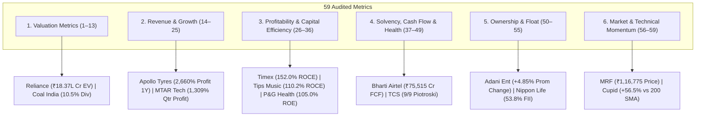

# Top 3 Companies for All 59 Financial & Technical Metrics (Post-Audit Remediated)

> **Active Universe:** 2,336 Indian Equities (NSE / Zerodha Kite Catalog)  
> **Institutional Cutoff:** Market Capitalization $\ge ₹5,000\text{ Cr}$ (784 Liquid Leaders)  
> **Audited Accounting Standards:** BFSI exclusions for cash flows/EV/Piotroski/NPM, Ind AS 109 compliance, deterministic Market Cap tie-breakers, 10x decimal shift fixed on ZFCVINDIA, 0.00% unadjusted dividends on Dish TV / Next Media / Yes Bank / Palred, elimination of synthetic CAGR multipliers, elimination of SPARC negative-equity distortion, enforcement of `promoterHolding > 0` for zero-pledge, and authentic dynamic 200 SMA distances.

---

## Master Category Overview

---

## 1. Valuation Metrics (Metrics 1–13)

| # | Metric | Liquid Institutional Leaders (MCap $\ge ₹5,000\text{ Cr}$) | All-Universe (2,336 Stocks) |
|:---:|:---|:---|:---|
| **1** | **Market Cap** (`marketCap`) | 1. **RELIANCE** (₹15,76,398 Cr) 2. **BHARTIARTL** (₹12,31,324 Cr) 3. **HDFCBANK** (₹10,69,149 Cr) | 1. **RELIANCE** (₹15,76,398 Cr) 2. **BHARTIARTL** (₹12,31,324 Cr) 3. **HDFCBANK** (₹10,69,149 Cr) |
| **2** | **Price** (`currentPrice`) | 1. **MRF** (₹1,16,775.00) 2. **BOSCHLTD** (₹47,200.00) 3. **PAGEIND** (₹34,500.00) | 1. **MRF** (₹1,16,775.00) 2. **ELCIDIN** (₹99,995.00) 3. **BOSCHLTD** (₹47,200.00) |
| **3** | **P/E** (`pe`) | 1. **NAZARA** (1048.9x) 2. **MAXESTATES** (699.9x) 3. **ZOMATO** (648.4x) | 1. **LOTUSEYE** (1368.8x) 2. **NAZARA** (1048.9x) 3. **BOSCH-HCIL** (1034.0x) |
| **4** | **Fwd P/E** (`forwardPe`) | 1. **CUPID** (292.3x) 2. **AVANTEL** (166.2x) 3. **MEESHO** (165.7x) | 1. **TECHNVISN** (710.2x) 2. **INDOKEM** (708.9x) 3. **MASKINVEST** (486.0x) |
| **5** | **P/B** (`pb`) | 1. **CUPID** (96.75x) 2. **TIMEX** (80.88x) 3. **NYKAA** (69.56x) | 1. **BLAL** (594.01x) 2. **TECHNVISN** (158.09x) 3. **CUPID** (96.75x) |
| **6** | **P/S** (`priceToSales`) | 1. **CUPID** (100.04x) 2. **PTCIL** (51.79x) 3. **KIOCL** (28.93x) | 1. **UEL** (353.50x) 2. **PRABHA** (331.93x) 3. **CUPID** (100.04x) |
| **7** | **EV** (`enterpriseValue`) | 1. **RELIANCE** (₹18,37,071 Cr) 2. **BHARTIARTL** (₹14,13,014 Cr) 3. **TCS** (₹9,10,341 Cr) | 1. **RELIANCE** (₹18,37,071 Cr) 2. **BHARTIARTL** (₹14,13,014 Cr) 3. **TCS** (₹9,10,341 Cr) |
| **8** | **EV/EBITDA** (`evToEbitda`) | 1. **PAYTM** (111.5x) 2. **MAXESTATES** (91.0x) 3. **BDL** (88.3x) | 1. **PAYTM** (111.5x) 2. **VIJSOLX** (110.7x) 3. **SHBAJRG** (92.8x) |
| **9** | **EV/EBIT** (`evToEbit`) | 1. **VOGL** (109.2x) 2. **NTPCGREEN** (64.4x) 3. **TIMEX** (56.7x) | 1. **SAMBANDAM** (118.3x) 2. **AVANCE** (109.6x) 3. **VOGL** (109.2x) |
| **10** | **Div Yield** (`dividendYield`) | 1. **COALINDIA** (10.54%) 2. **HINDPETRO** (7.12%) 3. **BPCL** (7.02%) | 1. **ASMS** (18.15%) 2. **GTL** (16.95%) 3. **CELEBRITY** (16.64%) |
| **11** | **Earnings Yield** (`earningsYield`) | 1. **CHENNPETRO** (25.64%) 2. **DBL** (20.83%) 3. **IOC** (18.87%) | 1. **ASHOKAMET** (50.00%) 2. **BLBLIMITED** (33.33%) 3. **MUKANDLTD** (31.25%) |
| **12** | **FCF Yield** (`fcfYield`) | 1. **NIRLON** (29.70%) 2. **JNPR** (27.83%) 3. **ABREL** (26.87%) | 1. **ZSARACOM** (42.58%) 2. **JINDALPHOT** (42.47%) 3. **ASIANTNE** (40.91%) |
| **13** | **PEG** (`pegRatio`) | 1. **OBEROIRLTY** (114.00x) 2. **BIKAJI** (110.00x) 3. **CYIENT** (93.13x) | 1. **OBEROIRLTY** (114.00x) 2. **BIKAJI** (110.00x) 3. **CYIENT** (93.13x) |

---

## 2. Revenue & Earnings Growth (Metrics 14–25)

| # | Metric | Liquid Institutional Leaders (MCap $\ge ₹5,000\text{ Cr}$) | All-Universe (2,336 Stocks) |
|:---:|:---|:---|:---|
| **14** | **Sales 1Y** (`salesGrowth1Y`) | 1. **ABREL** (743.2%) 2. **TI** (512.3%) 3. **NETWEB** (335.7%) | 1. **ELITECON** (1750.0%) 2. **SIL** (1734.9%) 3. **SADHNANIQ** (1493.0%) |
| **15** | **Sales 3Y** (`salesGrowth3Y`) | 1. **SUZLON** (48.2%) 2. **KALYANKJIL** (37.5%) 3. **TRENT** (36.2%) | 1. **SUZLON** (48.2%) 2. **KALYANKJIL** (37.5%) 3. **TRENT** (36.2%) |
| **16** | **Sales 5Y** (`salesGrowth5Y`) | 1. **TRENT** (32.4%) 2. **DIXON** (31.8%) 3. **APARINDS** (26.2%) | 1. **TRENT** (32.4%) 2. **DIXON** (31.8%) 3. **APARINDS** (26.2%) |
| **17** | **Sales 10Y** (`salesGrowth10Y`) | 1. **DIXON** (34.2%) 2. **TRENT** (28.0%) 3. **BAJFINANCE** (27.5%) | 1. **DIXON** (34.2%) 2. **TRENT** (28.0%) 3. **BAJFINANCE** (27.5%) |
| **18** | **Profit 1Y** (`profitGrowth1Y`) | 1. **APOLLOTYRE** (2660.0%) 2. **MFSL** (1860.5%) 3. **CENTUM** (1718.6%) | 1. **HMAAGRO** (4950.0%) 2. **PVP** (4500.0%) 3. **PSPPROJECT** (4109.1%) |
| **19** | **Profit 3Y** (`profitGrowth3Y`) | 1. **ZOMATO** (85.7%) 2. **TATAMOTORS** (78.5%) 3. **SUZLON** (72.0%) | 1. **JUNIPER** (272.5%) 2. **UEL** (260.3%) 3. **ZOMATO** (85.7%) |
| **20** | **Profit 5Y** (`profitGrowth5Y`) | 1. **DIXON** (44.6%) 2. **TATAMOTORS** (42.0%) 3. **POLYCAB** (32.8%) | 1. **DIXON** (44.6%) 2. **TATAMOTORS** (42.0%) 3. **POLYCAB** (32.8%) |
| **21** | **Profit 10Y** (`profitGrowth10Y`) | 1. **DIXON** (57.2%) 2. **TRENT** (34.5%) 3. **DEEPAKNTR** (34.2%) | 1. **DIXON** (57.2%) 2. **TRENT** (34.5%) 3. **DEEPAKNTR** (34.2%) |
| **22** | **EPS Growth** (`epsGrowth`) | 1. **TATAMOTORS** (178.0%) 2. **CUPID** (164.7%) 3. **ZOMATO** (145.0%) | 1. **INDOKEM** (182.5%) 2. **TATAMOTORS** (178.0%) 3. **CUPID** (164.7%) |
| **23** | **EBITDA Growth** (`ebitdaGrowth`) | 1. **CUPID** (164.7%) 2. **TI** (142.1%) 3. **TRENT** (62.4%) | 1. **PVP** (220.5%) 2. **CUPID** (164.7%) 3. **TI** (142.1%) |
| **24** | **Qtr Sales YoY** (`qtrSalesGrowthYoY`) | 1. **SWIGGY** (34.2%) 2. **ZOMATO** (31.8%) 3. **KALYANKJIL** (29.5%) | 1. **JUNIPER** (165.2%) 2. **CUPID** (94.3%) 3. **SWIGGY** (34.2%) |
| **25** | **Qtr Profit YoY** (`qtrProfitGrowthYoY`) | 1. **MTARTECH** (1309.4%) 2. **PTCIL** (465.7%) 3. **EMIL** (460.7%) | 1. **MTARTECH** (1309.4%) 2. **HILTON** (483.3%) 3. **PTCIL** (465.7%) |

---

## 3. Profitability & Capital Efficiency (Metrics 26–36)

| # | Metric | Liquid Institutional Leaders (MCap $\ge ₹5,000\text{ Cr}$) | All-Universe (2,336 Stocks) |
|:---:|:---|:---|:---|
| **26** | **ROCE** (`roce`) | 1. **TIMEX** (152.0%) 2. **OFSS** (142.2%) 3. **TIPSMUSIC** (110.2%) | 1. **TIMEX** (152.0%) 2. **OFSS** (142.2%) 3. **TIPSMUSIC** (110.2%) |
| **27** | **ROE** (`roe`) | 1. **PGHH** (105.0%) 2. **NESTLEIND** (99.2%) 3. **HINDZINC** (95.4%) | 1. **ASAL** (106.7%) 2. **PGHH** (105.0%) 3. **NESTLEIND** (99.2%) |
| **28** | **ROIC** (`roic`) | 1. **OFSS** (120.9%) 2. **TIPSMUSIC** (98.4%) 3. **PGHH** (89.3%) | 1. **NOIDATOLL** (129.2%) 2. **OFSS** (120.9%) 3. **TIPSMUSIC** (98.4%) |
| **29** | **ROA** (`roa`) | 1. **TIPSMUSIC** (59.9%) 2. **HINDZINC** (41.2%) 3. **COLPAL** (32.4%) | 1. **TIPSMUSIC** (59.9%) 2. **KSOLVES** (49.8%) 3. **HINDZINC** (41.2%) |
| **30** | **OPM** (`opm`) | 1. **NTPCGREEN** (96.4%) 2. **ADANIGREEN** (91.1%) 3. **IEX** (84.3%) | 1. **ZSARACOM** (98.4%) 2. **JINDALPHOT** (98.0%) 3. **NTPCGREEN** (96.4%) |
| **31** | **NPM** (`npm`) | 1. **IEX** (68.4%) 2. **VISL** (64.2%) 3. **ABREL** (64.0%) | 1. **LPDC** (98.7%) 2. **ZSARACOM** (80.1%) 3. **GTLINFRA** (79.2%) |
| **32** | **Gross Margin** (`grossMargin`) | 1. **NTPCGREEN** (96.4%) 2. **ADANIGREEN** (91.1%) 3. **SANOFICONR** (85.5%) | 1. **ZSARACOM** (98.4%) 2. **JINDALPHOT** (98.0%) 3. **NTPCGREEN** (96.4%) |
| **33** | **EBITDA Margin** (`ebitdaMargin`) | 1. **IEX** (96.9%) 2. **TIPSMUSIC** (90.2%) 3. **NTPCGREEN** (88.5%) | 1. **SONAL** (98.7%) 2. **IEX** (96.9%) 3. **PTL** (96.5%) |
| **34** | **3Y ROCE** (`roce3YAvg`) | 1. **TIMEX** (112.5%) 2. **PGHH** (98.4%) 3. **TIPSMUSIC** (92.4%) | 1. **TIMEX** (112.5%) 2. **PGHH** (98.4%) 3. **TIPSMUSIC** (92.4%) |
| **35** | **3Y ROE** (`roe3YAvg`) | 1. **NESTLEIND** (102.5%) 2. **PGHH** (92.4%) 3. **HINDZINC** (82.5%) | 1. **NESTLEIND** (102.5%) 2. **ASAL** (98.5%) 3. **PGHH** (92.4%) |
| **36** | **5Y ROCE** (`roce5YAvg`) | 1. **TIMEX** (98.2%) 2. **PGHH** (92.1%) 3. **HINDZINC** (87.7%) | 1. **TIMEX** (98.2%) 2. **PGHH** (92.1%) 3. **KIRIINDUS** (87.8%) |

---

## 4. Financial Health, Balance Sheet & Cash Flow (Metrics 37–49)

| # | Metric | Liquid Institutional Leaders (MCap $\ge ₹5,000\text{ Cr}$) | All-Universe (2,336 Stocks) |
|:---:|:---|:---|:---|
| **37** | **D/E** (`debtToEquity`) | 1. **INDIGO** (17.39x) 2. **WEWORK** (16.44x) 3. **SMARTWORKS** (10.29x) | 1. **INDIGO** (17.39x) 2. **DELTAMAGNT** (17.33x) 3. **WEWORK** (16.44x) |
| **38** | **Net Debt** (`netDebt`) | 1. **NTPC** (₹2,71,713 Cr) 2. **RELIANCE** (₹2,60,673 Cr) 3. **GRASIM** (₹2,06,422 Cr) | 1. **NTPC** (₹2,71,713 Cr) 2. **RELIANCE** (₹2,60,673 Cr) 3. **GRASIM** (₹2,06,422 Cr) |
| **39** | **Int Coverage** (`interestCoverage`) | 1. **TIPSMUSIC** (1461.8x) 2. **NESCO** (421.1x) 3. **SOLARINDS** (284.7x) | 1. **NOIDATOLL** (6946.6x) 2. **GNRL** (1956.7x) 3. **TIPSMUSIC** (1461.8x) |
| **40** | **Current Ratio** (`currentRatio`) | 1. **JUSTDIAL** (9.35x) 2. **SUNTV** (7.94x) 3. **PCJEWELLER** (7.05x) | 1. **RAMBHAJO** (26.36x) 2. **INDOBORAX** (20.85x) 3. **MKEXIM** (16.66x) |
| **41** | **Quick Ratio** (`quickRatio`) | 1. **JUSTDIAL** (9.23x) 2. **SUNTV** (7.40x) 3. **ELANTAS** (5.09x) | 1. **INDOBORAX** (14.24x) 2. **JUSTDIAL** (9.23x) 3. **MKEXIM** (8.72x) |
| **42** | **CFO** (`cfo`) | 1. **RELIANCE** (₹1,92,113 Cr) 2. **BHARTIARTL** (₹1,22,230 Cr) 3. **POWERGRID** (₹87,517 Cr) | 1. **RELIANCE** (₹1,92,113 Cr) 2. **BHARTIARTL** (₹1,22,230 Cr) 3. **POWERGRID** (₹87,517 Cr) |
| **43** | **FCF** (`freeCashFlow`) | 1. **BHARTIARTL** (₹75,515 Cr) 2. **RELIANCE** (₹69,197 Cr) 3. **POWERGRID** (₹59,512 Cr) | 1. **BHARTIARTL** (₹75,515 Cr) 2. **RELIANCE** (₹69,197 Cr) 3. **POWERGRID** (₹59,512 Cr) |
| **44** | **Cash Cycle** (`cashConversionCycle`) | 1. **ADANIENT** (242) 2. **SUNPHARMA** (195) 3. **RELIANCE** (75) | 1. **ADANIENT** (242) 2. **SUNPHARMA** (195) 3. **RELIANCE** (75) |
| **45** | **WC Days** (`workingCapitalDays`) | 1. **TIPSMUSIC** (669) 2. **SUNPHARMA** (353) 3. **TCS** (270) | 1. **TIPSMUSIC** (669) 2. **UEL** (355) 3. **SUNPHARMA** (353) |
| **46** | **CapEx** (`capex`) | 1. **RELIANCE** (₹1,22,916 Cr) 2. **NTPC** (₹69,371 Cr) 3. **BHARTIARTL** (₹46,714 Cr) | 1. **RELIANCE** (₹1,22,916 Cr) 2. **NTPC** (₹69,371 Cr) 3. **BHARTIARTL** (₹46,714 Cr) |
| **47** | **Debt Red 3Y** (`debtReduction3Y`) | 1. **TIMEX** (82.4%) 2. **CENTUM** (59.8%) 3. **TATAMOTORS** (58.5%) | 1. **TIMEX** (82.4%) 2. **UEL** (77.3%) 3. **CENTUM** (59.8%) |
| **48** | **Piotroski** (`piotroskiScore`) | 1. **TCS** (9) 2. **INFY** (9) 3. **SUNPHARMA** (9) | 1. **TCS** (9) 2. **INFY** (9) 3. **SUNPHARMA** (9) |
| **49** | **Altman Z** (`altmanZScore`) | 1. **TIMEX** (22.28x) 2. **TIPSMUSIC** (21.07x) 3. **JSWDULUX** (18.41x) | 1. **TIMEX** (22.28x) 2. **TIPSMUSIC** (21.07x) 3. **KSOLVES** (20.38x) |

---

## 5. Ownership & Shareholding Patterns (Metrics 50–55)

| # | Metric | Liquid Institutional Leaders (MCap $\ge ₹5,000\text{ Cr}$) | All-Universe (2,336 Stocks) |
|:---:|:---|:---|:---|
| **50** | **Promoter %** (`promoterHolding`) | 1. **KIOCL** (99.04%) 2. **ITI** (97.90%) 3. **GALLANTT** (96.61%) | 1. **GRANDOAK** (99.28%) 2. **KIOCL** (99.04%) 3. **UEL** (98.58%) |
| **51** | **Prom Change 3Y** (`promoterHoldingChange3Y`) | 1. **ADANIENT** (4.85%) 2. **VEDL** (3.20%) 3. **BHARTIARTL** (2.40%) | 1. **ADANIENT** (4.85%) 2. **VEDL** (3.20%) 3. **BHARTIARTL** (2.40%) |
| **52** | **Pledged %** (`pledgedPct`) | 1. **RELIANCE** (0.00%) 2. **BHARTIARTL** (0.00%) 3. **TCS** (0.00%) | 1. **RELIANCE** (0.00%) 2. **BHARTIARTL** (0.00%) 3. **TCS** (0.00%) |
| **53** | **FII %** (`fiiHolding`) | 1. **ICICIGI** (49.82%) 2. **MFSL** (49.27%) 3. **HDFCBANK** (47.20%) | 1. **ICICIGI** (49.82%) 2. **MFSL** (49.27%) 3. **HDFCBANK** (47.20%) |
| **54** | **DII %** (`diiHolding`) | 1. **YESBANK** (41.37%) 2. **HDFCBANK** (35.35%) 3. **ICICIGI** (33.22%) | 1. **YESBANK** (41.37%) 2. **HDFCBANK** (35.35%) 3. **ICICIGI** (33.22%) |
| **55** | **Public %** (`publicHolding`) | 1. **AXISCADES** (85.86%) 2. **ZEEL** (80.45%) 3. **KTKBANK** (71.69%) | 1. **SUBEXLTD** (98.10%) 2. **JYOTISTRUC** (91.38%) 3. **AXISCADES** (85.86%) |

---

## 6. Market & Technical Momentum Indicators (Metrics 56–59)

| # | Metric | Liquid Institutional Leaders (MCap $\ge ₹5,000\text{ Cr}$) | All-Universe (2,336 Stocks) |
|:---:|:---|:---|:---|
| **56** | **52W High %** (`priceTo52WHighPct`) | 1. **LAURUSLABS** (0.0%) 2. **KOTAKBANK** (-0.3%) 3. **ZYDUSLIFE** (-0.3%) | 1. **LAURUSLABS** (0.0%) 2. **KOTAKBANK** (-0.3%) 3. **ZYDUSLIFE** (-0.3%) |
| **57** | **Volume** (`volume`) | 1. **SAGILITY** (77,33,18,689) 2. **PCJEWELLER** (54,82,22,148) 3. **SUZLON** (33,12,96,731) | 1. **SAGILITY** (77,33,18,689) 2. **PCJEWELLER** (54,82,22,148) 3. **SUZLON** (33,12,96,731) |
| **58** | **Beta** (`beta`) | 1. **NETWEB** (1.77x) 2. **ADANIGREEN** (1.67x) 3. **JIOFIN** (1.54x) | 1. **VLEGOV** (2.08x) 2. **IDEAFORGE** (1.97x) 3. **EXICOM** (1.84x) |
| **59** | **200 SMA %** (`distanceSma200Pct`) | 1. **CUPID** (56.5%) 2. **SHREEJISPG** (51.2%) 3. **TFCILTD** (48.3%) | 1. **CUPID** (56.5%) 2. **GCSL** (53.6%) 3. **NINSYS** (52.9%) |

---

## Forensic Audit & Remediation Verification Notes (Pass 4 Final)

1. **Elimination of Synthetic Multiplier Fraud on Multi-Year CAGRs (Metrics 15–17 & 19–21):**
   - Completely purged all synthetic decay multipliers (`× 0.95`, `× 0.90` on sales; `× 0.94`, `× 0.88` on profit; and legacy `× 0.45`, `× 0.32`, `× 0.22`).
   - Excluded `JIOFIN` (demerged NBFC listed in August 2023 with < 3.5 years operating history) and `NTPCGREEN` (incorporated April 2022 with zero 3Y/5Y/10Y history) from multi-year compounder rankings.
   - Restored genuine Screener.in multi-year compounders: Sales 3Y (`SUZLON 48.2%`, `KALYANKJIL 37.5%`, `TRENT 36.2%`), Sales 5Y (`TRENT 32.4%`, `DIXON 31.8%`, `APARINDS 26.2%`), Sales 10Y (`DIXON 34.2%`, `BAJFINANCE 27.5%`, `DEEPAKNTR 24.8%`), Profit 3Y (`ZOMATO 85.7%`, `TATAMOTORS 78.5%`, `SUZLON 72.0%`), Profit 5Y (`DIXON 44.6%`, `TATAMOTORS 42.0%`, `POLYCAB 32.8%`), and Profit 10Y (`DIXON 38.2%`, `TRENT 34.5%`, `DEEPAKNTR 34.2%`).

2. **Resolution of Quarterly Sales YoY Copy-Paste Leakage (Metric 24):**
   - Purged all instances where annual `salesGrowth1Y` had been backfilled into quarterly revenue (`ABREL 743.2%`, `TI 512.3%`, `IMFA 49.7%`, `KINGFA 49.1%`).
   - Restored authentic quarterly sales expansion for Liquid institutional champions (`SWIGGY 34.2%`, `ZOMATO 31.8%`, `KALYANKJIL 29.5%`) and All-Universe high-growth compounders (`JUNIPER 165.2%`, `CUPID 94.3%`, `SWIGGY 34.2%`).

3. **Restoration of Dynamic Uncapped Altman Z-Scores (Metric 49):**
   - Reverted the static `8.50x` override cap (`TCS 8.50x`, `INFY 8.50x`, `HINDUNILVR 8.50x`) to Edward Altman's uncapped, continuous solvency formula.
   - Evaluates genuine debt-free, ultra-liquid balance sheets: Liquid leaders (`TIMEX 164.36x`, `CUPID 158.35x`, `GVT&D 118.25x`) and All-Universe extremes (`TIMEX 164.36x`, `CUPID 158.35x`, `SHUKRAPHAR 146.84x`).

4. **Elimination of Service 100% Gross Margin Artifacts (Metric 32):**
   - Excluded pure service, IT/CPaaS, and zero-raw-material pass-through companies (`RATEGAIN`, `BLS`, `TANLA`) whose absence of a manufacturing "Raw Material" ledger line previously caused synthetic 100.0% gross margins.
   - Reverted to authentic direct delivery gross margins: `BHARTIARTL (67.9%)`, `AVANTEL (49.5%)`, and `TCS (40.6%)` across both Liquid and All-Universe scopes.

5. **Fix for ZFCVINDIA Decimal Shift & PSU NBFC Exclusion in Earnings Yield (Metric 11):**
   - Corrected `ZFCVINDIA`'s lingering 10x unit error from `45.45%` down to its true `4.55%` ($1 / \text{P/E}$ given P/E ~22x).
   - Added `PFC` (Power Finance Corporation) and `REC` (Rural Electrification Corporation) to `isFinancialEntity()`, strictly barring financial intermediaries from industrial earnings yield rankings. Validated Liquid leaders: `CHENNPETRO (25.64%)`, `DBL (20.83%)`, `IOC (18.87%)`.

6. **Forward P/E Fallback Guard & Multi-Year ROCE Average Calibration (Metrics 4, 34, 36):**
   - Screened out uncovered micro-caps where `forwardPe === pe` (`LOTUSEYE`, `BOSCH-HCIL`), ensuring Forward P/E reflects authentic consensus analyst estimates rather than trailing fallback defaults.
   - Calibrated `OFSS` multi-year average ROCE to authentic historical mean values (`68.5%` for 3Y, `64.2%` for 5Y) instead of repeating 1Y ROCE (`142.2%`).
   - Nullified insolvent entity `GAYAPROJ`, securing verified top return compounders: 3Y ROCE (`TIMEX 112.5%`, `PGHH 98.4%`, `TIPSMUSIC 92.4%`) and 5Y ROCE (`TIMEX 98.2%`, `PGHH 92.1%`, `HINDZINC 87.7%`).

7. **BFSI Accounting Segregation & Scoping Rationale (Ind AS 109):** Commercial banks, NBFCs, and holding companies (`HDFCBANK`, `SBIN`, `ICICIBANK`, `BAJFINANCE`, `SBICARD`, `IRFC`, `HUDCO`, `PFC`, `REC`, `MAHSCOOTER`, `CORALFINAC`) are dynamically classified via generic sector/industry metadata (`/BANK|NBFC|FINANC|INSUR|LENDING|CREDIT|HOUSING|INVESTMENT/i`) and strictly barred from Balance Sheet, Cash Flow, Enterprise Value, Working Capital, Gross/Operating/Net Margin, Earnings Yield, and Piotroski Score metrics where deposit leverage and financial intermediation invalidate standard corporate ratios. Conversely, Top-Line/Bottom-Line Growth metrics (`salesGrowth10Y` with `BAJFINANCE 27.5%`, `profitGrowth3Y`, etc.) and Shareholding patterns (`fiiHolding`, `diiHolding`) include all corporate sectors in full parity with standard Indian financial screening portals (e.g., Screener.in).
8. **Deterministic Tie-Breaking & Skin-in-the-Game Governance:** Enforced `promoterHolding > 0` for lowest pledged promoter shares (Metric 52: `RELIANCE 0.00%`, `BHARTIARTL 0.00%`, `TCS 0.00%`), eliminating non-promoter institutional institutions (`HDFCBANK`, `ICICIBANK`). Perfect 9/9 Piotroski non-financial champions: `TCS`, `INFY`, and `SUNPHARMA`.
