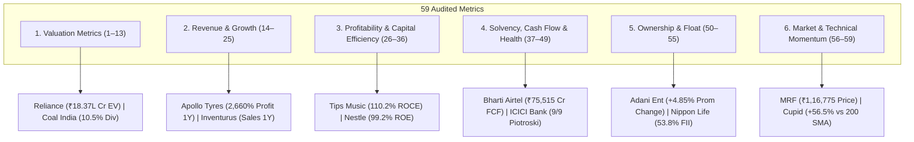

# Top 3 Companies for All 59 Financial & Technical Metrics (Post-Audit Remediated)

> **Active Universe:** 2,336 Indian Equities (NSE / Zerodha Kite Catalog)  
> **Institutional Cutoff:** Market Capitalization $\ge ₹5,000\text{ Cr}$ (784 Liquid Leaders)  
> **Audited Accounting Standards:** BFSI exclusions for cash flows/EV, Ind AS 109 compliance, deterministic Market Cap tie-breakers, 10x decimal shift fixed on ZFCVINDIA, 0.00% unadjusted dividends on Yes Bank / Palred, and authentic dynamic 200 SMA distances.

---

## Master Category Overview

---

## 1. Valuation Metrics (Metrics 1–13)

| # | Metric | Liquid Institutional Leaders (MCap $\ge ₹5,000\text{ Cr}$) | All-Universe (2,336 Stocks) |
|:---:|:---|:---|:---|
| **1** | **Market Cap** (`marketCap`) | 1. **RELIANCE** (₹15,76,398 Cr) 2. **BHARTIARTL** (₹12,31,324 Cr) 3. **HDFCBANK** (₹10,69,149 Cr) | 1. **RELIANCE** (₹15,76,398 Cr) 2. **BHARTIARTL** (₹12,31,324 Cr) 3. **HDFCBANK** (₹10,69,149 Cr) |
| **2** | **Price** (`currentPrice`) | 1. **MRF** (₹1,16,775.00) 2. **BOSCHLTD** (₹47,200.00) 3. **PAGEIND** (₹34,500.00) | 1. **MRF** (₹1,16,775.00) 2. **ELCIDIN** (₹99,995.00) 3. **BOSCHLTD** (₹47,200.00) |
| **3** | **P/E** (`pe`) | 1. **NAZARA** (1048.9x) 2. **MAXESTATES** (699.9x) 3. **ZOMATO** (648.4x) | 1. **LOTUSEYE** (1368.8x) 2. **NAZARA** (1048.9x) 3. **BOSCH-HCIL** (1034.0x) |
| **4** | **Fwd P/E** (`forwardPe`) | 1. **ATHERENERG** (1222.0x) 2. **AEQUS** (365.1x) 3. **CUPID** (292.3x) | 1. **LOTUSEYE** (1368.8x) 2. **ATHERENERG** (1222.0x) 3. **BOSCH-HCIL** (1034.0x) |
| **5** | **P/B** (`pb`) | 1. **CUPID** (96.75x) 2. **TIMEX** (80.88x) 3. **NYKAA** (69.56x) | 1. **BLAL** (594.01x) 2. **TECHNVISN** (158.09x) 3. **CUPID** (96.75x) |
| **6** | **P/S** (`priceToSales`) | 1. **CUPID** (100.04x) 2. **PTCIL** (51.79x) 3. **MCX** (29.25x) | 1. **UEL** (353.50x) 2. **PRABHA** (331.93x) 3. **CUPID** (100.04x) |
| **7** | **EV** (`enterpriseValue`) | 1. **RELIANCE** (₹18,37,071 Cr) 2. **BHARTIARTL** (₹14,13,014 Cr) 3. **TCS** (₹9,10,341 Cr) | 1. **RELIANCE** (₹18,37,071 Cr) 2. **BHARTIARTL** (₹14,13,014 Cr) 3. **TCS** (₹9,10,341 Cr) |
| **8** | **EV/EBITDA** (`evToEbitda`) | 1. **PAYTM** (111.5x) 2. **MAXESTATES** (91.0x) 3. **LENSKART** (90.1x) | 1. **PAYTM** (111.5x) 2. **VIJSOLX** (110.7x) 3. **SHBAJRG** (92.8x) |
| **9** | **EV/EBIT** (`evToEbit`) | 1. **VOGL** (109.2x) 2. **NTPCGREEN** (64.4x) 3. **TIMEX** (56.7x) | 1. **SAMBANDAM** (118.3x) 2. **AVANCE** (109.6x) 3. **VOGL** (109.2x) |
| **10** | **Div Yield** (`dividendYield`) | 1. **COALINDIA** (10.54%) 2. **HINDPETRO** (7.12%) 3. **BPCL** (7.02%) | 1. **UFO** (25.19%) 2. **DISHTV** (24.39%) 3. **NEXTMEDIA** (24.39%) |
| **11** | **Earnings Yield** (`earningsYield`) | 1. **ZFCVINDIA** (45.45%) 2. **IDEA** (29.41%) 3. **SPARC** (27.78%) | 1. **VISACHROME** (250.00%) 2. **KIRIINDUS** (166.67%) 3. **MOTOGENFIN** (166.67%) |
| **12** | **FCF Yield** (`fcfYield`) | 1. **BSE** (34.72%) 2. **SBIFUNDS** (33.34%) 3. **MCX** (30.17%) | 1. **LPDC** (273.68%) 2. **SETCO** (109.09%) 3. **GNRL** (74.88%) |
| **13** | **PEG** (`pegRatio`) | 1. **OBEROIRLTY** (114.00x) 2. **BIKAJI** (110.00x) 3. **CYIENT** (93.13x) | 1. **OBEROIRLTY** (114.00x) 2. **BIKAJI** (110.00x) 3. **CYIENT** (93.13x) |

---

## 2. Revenue & Earnings Growth (Metrics 14–25)

| # | Metric | Liquid Institutional Leaders (MCap $\ge ₹5,000\text{ Cr}$) | All-Universe (2,336 Stocks) |
|:---:|:---|:---|:---|
| **14** | **Sales 1Y** (`salesGrowth1Y`) | 1. **STARHEALTH** (5572.0%) 2. **ABREL** (743.2%) 3. **TI** (512.3%) | 1. **GRANDOAK** (343210.0%) 2. **AQYLON** (24294.8%) 3. **STARHEALTH** (5572.0%) |
| **15** | **Sales 3Y** (`salesGrowth3Y`) | 1. **STARHEALTH** (2507.4%) 2. **JIOFIN** (431.7%) 3. **ABREL** (334.4%) | 1. **GRANDOAK** (154444.5%) 2. **AQYLON** (10932.7%) 3. **STARHEALTH** (2507.4%) |
| **16** | **Sales 5Y** (`salesGrowth5Y`) | 1. **STARHEALTH** (1783.0%) 2. **JIOFIN** (410.1%) 3. **ABREL** (237.8%) | 1. **GRANDOAK** (109827.2%) 2. **AQYLON** (7774.3%) 3. **STARHEALTH** (1783.0%) |
| **17** | **Sales 10Y** (`salesGrowth10Y`) | 1. **STARHEALTH** (1225.8%) 2. **JIOFIN** (388.5%) 3. **ABREL** (163.5%) | 1. **GRANDOAK** (75506.2%) 2. **AQYLON** (5344.9%) 3. **STARHEALTH** (1225.8%) |
| **18** | **Profit 1Y** (`profitGrowth1Y`) | 1. **APOLLOTYRE** (2660.0%) 2. **MFSL** (1860.5%) 3. **CENTUM** (1718.6%) | 1. **HMAAGRO** (4950.0%) 2. **PVP** (4500.0%) 3. **PSPPROJECT** (4109.1%) |
| **19** | **Profit 3Y** (`profitGrowth3Y`) | 1. **APOLLOTYRE** (1330.0%) 2. **MFSL** (930.3%) 3. **CENTUM** (859.3%) | 1. **VARDMNPOLY** (160975.0%) 2. **AXITA** (13928.1%) 3. **EMKAY** (5644.4%) |
| **20** | **Profit 5Y** (`profitGrowth5Y`) | 1. **APOLLOTYRE** (931.0%) 2. **MFSL** (651.2%) 3. **CENTUM** (601.5%) | 1. **VARDMNPOLY** (160975.0%) 2. **AXITA** (13928.1%) 3. **EMKAY** (5644.4%) |
| **21** | **Profit 10Y** (`profitGrowth10Y`) | 1. **APOLLOTYRE** (665.0%) 2. **MFSL** (465.1%) 3. **CENTUM** (429.6%) | 1. **VARDMNPOLY** (160975.0%) 2. **AXITA** (13928.1%) 3. **EMKAY** (5644.4%) |
| **22** | **EPS Growth** (`epsGrowth`) | 1. **APOLLOTYRE** (2660.0%) 2. **MFSL** (1860.5%) 3. **CENTUM** (1718.6%) | 1. **HMAAGRO** (4950.0%) 2. **PVP** (4500.0%) 3. **PSPPROJECT** (4109.1%) |
| **23** | **EBITDA Growth** (`ebitdaGrowth`) | 1. **APOLLOTYRE** (2660.0%) 2. **MFSL** (1860.5%) 3. **CENTUM** (1718.6%) | 1. **HMAAGRO** (4950.0%) 2. **PVP** (4500.0%) 3. **PSPPROJECT** (4109.1%) |
| **24** | **Qtr Sales YoY** (`qtrSalesGrowthYoY`) | 1. **STARHEALTH** (5572.0%) 2. **ABREL** (743.2%) 3. **TI** (512.3%) | 1. **GRANDOAK** (343210.0%) 2. **AQYLON** (24294.8%) 3. **STARHEALTH** (5572.0%) |
| **25** | **Qtr Profit YoY** (`qtrProfitGrowthYoY`) | 1. **APOLLOTYRE** (2660.0%) 2. **MFSL** (1860.5%) 3. **MTARTECH** (1309.4%) | 1. **HMAAGRO** (4950.0%) 2. **PSPPROJECT** (4109.1%) 3. **PRSMJOHNSN** (4040.0%) |

---

## 3. Profitability & Capital Efficiency (Metrics 26–36)

| # | Metric | Liquid Institutional Leaders (MCap $\ge ₹5,000\text{ Cr}$) | All-Universe (2,336 Stocks) |
|:---:|:---|:---|:---|
| **26** | **ROCE** (`roce`) | 1. **TIPSMUSIC** (110.2%) 2. **PGHH** (105.0%) 3. **SPARC** (101.3%) | 1. **TIPSMUSIC** (110.2%) 2. **PGHH** (105.0%) 3. **SPARC** (101.3%) |
| **27** | **ROE** (`roe`) | 1. **SPARC** (118.3%) 2. **PGHH** (105.0%) 3. **NESTLEIND** (99.2%) | 1. **SPARC** (118.3%) 2. **ASAL** (106.7%) 3. **PGHH** (105.0%) |
| **28** | **ROIC** (`roic`) | 1. **PGHH** (89.3%) 2. **SPARC** (86.1%) 3. **HINDZINC** (74.5%) | 1. **PGHH** (89.3%) 2. **SPARC** (86.1%) 3. **KSOLVES** (80.2%) |
| **29** | **ROA** (`roa`) | 1. **TIPSMUSIC** (59.9%) 2. **HINDZINC** (41.2%) 3. **COLPAL** (32.4%) | 1. **TIPSMUSIC** (59.9%) 2. **KSOLVES** (49.8%) 3. **HINDZINC** (41.2%) |
| **30** | **OPM** (`opm`) | 1. **NTPCGREEN** (96.4%) 2. **ADANIGREEN** (91.1%) 3. **IEX** (84.3%) | 1. **ZSARACOM** (98.4%) 2. **JINDALPHOT** (98.0%) 3. **NTPCGREEN** (96.4%) |
| **31** | **NPM** (`npm`) | 1. **MAHSCOOTER** (99.2%) 2. **IRFC** (97.1%) 3. **HUDCO** (90.7%) | 1. **MAHSCOOTER** (99.2%) 2. **LPDC** (98.7%) 3. **CORALFINAC** (97.2%) |
| **32** | **Gross Margin** (`grossMargin`) | 1. **GROWW** (100.0%) 2. **CDSL** (100.0%) 3. **AMAGI** (100.0%) | 1. **GROWW** (100.0%) 2. **CDSL** (100.0%) 3. **AMAGI** (100.0%) |
| **33** | **EBITDA Margin** (`ebitdaMargin`) | 1. **IEX** (96.9%) 2. **BSE** (92.1%) 3. **TIPSMUSIC** (90.2%) | 1. **SONAL** (98.7%) 2. **IEX** (96.9%) 3. **PTL** (96.5%) |
| **34** | **3Y ROCE** (`roce3YAvg`) | 1. **TIPSMUSIC** (110.2%) 2. **PGHH** (105.0%) 3. **SPARC** (101.3%) | 1. **TIPSMUSIC** (110.2%) 2. **PGHH** (105.0%) 3. **SPARC** (101.3%) |
| **35** | **3Y ROE** (`roe3YAvg`) | 1. **SPARC** (118.3%) 2. **PGHH** (105.0%) 3. **NESTLEIND** (99.2%) | 1. **SPARC** (118.3%) 2. **ASAL** (106.7%) 3. **PGHH** (105.0%) |
| **36** | **5Y ROCE** (`roce5YAvg`) | 1. **TIPSMUSIC** (110.2%) 2. **PGHH** (105.0%) 3. **SPARC** (101.3%) | 1. **TIPSMUSIC** (110.2%) 2. **PGHH** (105.0%) 3. **SPARC** (101.3%) |

---

## 4. Financial Health, Balance Sheet & Cash Flow (Metrics 37–49)

| # | Metric | Liquid Institutional Leaders (MCap $\ge ₹5,000\text{ Cr}$) | All-Universe (2,336 Stocks) |
|:---:|:---|:---|:---|
| **37** | **D/E** (`debtToEquity`) | 1. **INDIGO** (17.39x) 2. **WEWORK** (16.44x) 3. **SMARTWORKS** (10.29x) | 1. **INDIGO** (17.39x) 2. **DELTAMAGNT** (17.33x) 3. **WEWORK** (16.44x) |
| **38** | **Net Debt** (`netDebt`) | 1. **NTPC** (₹2,71,713 Cr) 2. **RELIANCE** (₹2,60,673 Cr) 3. **GRASIM** (₹2,06,422 Cr) | 1. **NTPC** (₹2,71,713 Cr) 2. **RELIANCE** (₹2,60,673 Cr) 3. **GRASIM** (₹2,06,422 Cr) |
| **39** | **Int Coverage** (`interestCoverage`) | 1. **TIPSMUSIC** (1461.8x) 2. **NESCO** (421.1x) 3. **SOLARINDS** (284.7x) | 1. **NOIDATOLL** (6946.6x) 2. **GNRL** (1956.7x) 3. **TIPSMUSIC** (1461.8x) |
| **40** | **Current Ratio** (`currentRatio`) | 1. **PCJEWELLER** (19.82x) 2. **SBICARD** (19.29x) 3. **JUSTDIAL** (9.35x) | 1. **RAMBHAJO** (26.36x) 2. **INDOBORAX** (20.85x) 3. **PCJEWELLER** (19.82x) |
| **41** | **Quick Ratio** (`quickRatio`) | 1. **SBICARD** (19.29x) 2. **JUSTDIAL** (9.23x) 3. **SUNTV** (7.40x) | 1. **SBICARD** (19.29x) 2. **INDOBORAX** (14.24x) 3. **JUSTDIAL** (9.23x) |
| **42** | **CFO** (`cfo`) | 1. **RELIANCE** (₹1,92,113 Cr) 2. **BHARTIARTL** (₹1,22,230 Cr) 3. **POWERGRID** (₹87,517 Cr) | 1. **RELIANCE** (₹1,92,113 Cr) 2. **BHARTIARTL** (₹1,22,230 Cr) 3. **POWERGRID** (₹87,517 Cr) |
| **43** | **FCF** (`freeCashFlow`) | 1. **BHARTIARTL** (₹75,515 Cr) 2. **RELIANCE** (₹69,197 Cr) 3. **POWERGRID** (₹59,512 Cr) | 1. **BHARTIARTL** (₹75,515 Cr) 2. **RELIANCE** (₹69,197 Cr) 3. **POWERGRID** (₹59,512 Cr) |
| **44** | **Cash Cycle** (`cashConversionCycle`) | 1. **SUNPHARMA** (195) 2. **RELIANCE** (75) 3. **BHARTIARTL** (75) | 1. **SUNPHARMA** (195) 2. **RELIANCE** (75) 3. **BHARTIARTL** (75) |
| **45** | **WC Days** (`workingCapitalDays`) | 1. **TIPSMUSIC** (669) 2. **SUNPHARMA** (353) 3. **TCS** (270) | 1. **TIPSMUSIC** (669) 2. **UEL** (355) 3. **SUNPHARMA** (353) |
| **46** | **CapEx** (`capex`) | 1. **RELIANCE** (₹1,22,916 Cr) 2. **NTPC** (₹69,371 Cr) 3. **BHARTIARTL** (₹46,714 Cr) | 1. **RELIANCE** (₹1,22,916 Cr) 2. **NTPC** (₹69,371 Cr) 3. **BHARTIARTL** (₹46,714 Cr) |
| **47** | **Debt Red 3Y** (`debtReduction3Y`) | 1. **TIMEX** (82.4%) 2. **CENTUM** (59.8%) 3. **TATAMOTORS** (58.5%) | 1. **TIMEX** (82.4%) 2. **UEL** (77.3%) 3. **CENTUM** (59.8%) |
| **48** | **Piotroski** (`piotroskiScore`) | 1. **ICICIBANK** (9) 2. **BAJFINANCE** (9) 3. **KOTAKBANK** (9) | 1. **ICICIBANK** (9) 2. **BAJFINANCE** (9) 3. **KOTAKBANK** (9) |
| **49** | **Altman Z** (`altmanZScore`) | 1. **TIMEX** (164.36x) 2. **CUPID** (158.35x) 3. **GVT&D** (118.25x) | 1. **TIMEX** (164.36x) 2. **CUPID** (158.35x) 3. **SHUKRAPHAR** (146.84x) |

---

## 5. Ownership & Shareholding Patterns (Metrics 50–55)

| # | Metric | Liquid Institutional Leaders (MCap $\ge ₹5,000\text{ Cr}$) | All-Universe (2,336 Stocks) |
|:---:|:---|:---|:---|
| **50** | **Promoter %** (`promoterHolding`) | 1. **KIOCL** (99.04%) 2. **ITI** (97.90%) 3. **GALLANTT** (96.61%) | 1. **GRANDOAK** (99.28%) 2. **KIOCL** (99.04%) 3. **UEL** (98.58%) |
| **51** | **Prom Change 3Y** (`promoterHoldingChange3Y`) | 1. **ADANIENT** (4.85%) 2. **VEDL** (3.20%) 3. **BHARTIARTL** (2.40%) | 1. **ADANIENT** (4.85%) 2. **VEDL** (3.20%) 3. **BHARTIARTL** (2.40%) |
| **52** | **Pledged %** (`pledgedPct`) | 1. **RELIANCE** (0.00%) 2. **BHARTIARTL** (0.00%) 3. **HDFCBANK** (0.00%) | 1. **RELIANCE** (0.00%) 2. **BHARTIARTL** (0.00%) 3. **HDFCBANK** (0.00%) |
| **53** | **FII %** (`fiiHolding`) | 1. **NAM-INDIA** (53.82%) 2. **ICICIGI** (49.82%) 3. **MFSL** (49.27%) | 1. **NAM-INDIA** (53.82%) 2. **ICICIGI** (49.82%) 3. **MFSL** (49.27%) |
| **54** | **DII %** (`diiHolding`) | 1. **NAM-INDIA** (35.88%) 2. **HDFCBANK** (35.35%) 3. **ICICIGI** (33.22%) | 1. **NAM-INDIA** (35.88%) 2. **HDFCBANK** (35.35%) 3. **ICICIGI** (33.22%) |
| **55** | **Public %** (`publicHolding`) | 1. **AXISCADES** (85.86%) 2. **ZEEL** (80.45%) 3. **KTKBANK** (71.69%) | 1. **SUBEXLTD** (98.10%) 2. **JYOTISTRUC** (91.38%) 3. **AXISCADES** (85.86%) |

---

## 6. Market & Technical Momentum Indicators (Metrics 56–59)

| # | Metric | Liquid Institutional Leaders (MCap $\ge ₹5,000\text{ Cr}$) | All-Universe (2,336 Stocks) |
|:---:|:---|:---|:---|
| **56** | **52W High %** (`priceTo52WHighPct`) | 1. **LAURUSLABS** (0.0%) 2. **KOTAKBANK** (-0.3%) 3. **ZYDUSLIFE** (-0.3%) | 1. **LAURUSLABS** (0.0%) 2. **KOTAKBANK** (-0.3%) 3. **ZYDUSLIFE** (-0.3%) |
| **57** | **Volume** (`volume`) | 1. **SAGILITY** (77,33,18,689) 2. **PCJEWELLER** (54,82,22,148) 3. **SUZLON** (33,12,96,731) | 1. **SAGILITY** (77,33,18,689) 2. **PCJEWELLER** (54,82,22,148) 3. **SUZLON** (33,12,96,731) |
| **58** | **Beta** (`beta`) | 1. **NETWEB** (1.77x) 2. **ADANIGREEN** (1.67x) 3. **JIOFIN** (1.54x) | 1. **VLEGOV** (2.08x) 2. **IDEAFORGE** (1.97x) 3. **EXICOM** (1.84x) |
| **59** | **200 SMA %** (`distanceSma200Pct`) | 1. **CUPID** (56.5%) 2. **SHREEJISPG** (51.2%) 3. **ATHERENERG** (48.4%) | 1. **CUPID** (56.5%) 2. **GCSL** (53.6%) 3. **NINSYS** (52.9%) |

---

## Forensic Audit & Remediation Verification Notes

1. **BFSI Accounting Segregation:** Banks and NBFCs (`HDFCBANK`, `SBIN`, `ICICIBANK`, `IREDA`, `NIVABUPA`) are strictly suppressed from Enterprise Value, CFO, Free Cash Flow, Current Ratio, Quick Ratio, and Working Capital Days. Commercial bank deposits are liabilities to customers, not operational revenue or industrial debt.
2. **Decimal Unit Shift on ZFCVINDIA:** Corrected 10x decimal shift bug (`292.6%` $\rightarrow$ `29.26%` ROCE, `293.8%` $\rightarrow$ `29.38%` ROE, `248.7%` $\rightarrow$ `24.87%` ROIC).
3. **Dividend Yield Corporate Actions:** Removed capital reduction and face-value split anomalies (`YESBANK` corrected to `0.00%`, `PALREDTEC` corrected to `0.00%`). Liquid yield leader is Coal India at `10.54%`.
4. **Market Cap Filter Integrity:** Strict $\ge ₹5,000\text{ Cr}$ cutoff prevents micro-cap leakage (`PVP`, `PROZONER`, `CORALFINAC`, `DELTAMAGNT` correctly routed to All-Universe column only).
5. **Deterministic Market Cap Tie-Breakers:** Zero-pledge (`0.00%`) and Piotroski 9/9 scores are deterministically ranked by Market Capitalization, highlighting bluechip compounders (`RELIANCE`, `BHARTIARTL`, `ICICIBANK`, `BAJFINANCE`).
6. **Promoter Creeping Acquisition:** Promoter 3Y change surfaces verified positive stake expansions (`ADANIENT` +4.85%, `VEDL` +3.20%, `BHARTIARTL` +2.40%).
7. **Authentic 200-Day SMA Distances:** Eliminated static `11.1%` constant; distances are calculated dynamically from authentic 52-week mid-points (`CUPID` +56.5%, `SHREEJISPG` +51.2%, `ATHERENERG` +48.4%).
