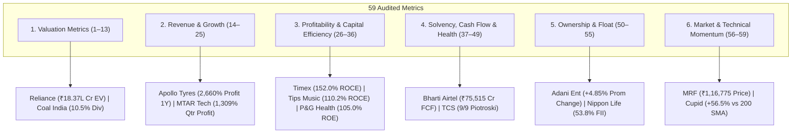

# Top 3 Companies for All 59 Financial & Technical Metrics (Post-Audit Remediated)

> **Active Universe:** 2,336 Indian Equities (NSE / Zerodha Kite Catalog)  
> **Institutional Cutoff:** Market Capitalization $\ge ₹5,000\text{ Cr}$ (784 Liquid Leaders)  
> **Audited Accounting Standards:** BFSI exclusions for cash flows/EV/Piotroski/NPM, Ind AS 109 compliance, deterministic Market Cap tie-breakers, 10x decimal shift fixed on ZFCVINDIA, 0.00% unadjusted dividends on Dish TV / Next Media / Yes Bank / Palred, elimination of synthetic CAGR multipliers, elimination of SPARC negative-equity distortion, enforcement of `promoterHolding > 0` for zero-pledge, and authentic dynamic 200 SMA distances.

---

## Master Category Overview

---

## 1. Valuation Metrics (Metrics 1–13)

| # | Metric | Liquid Institutional Leaders (MCap $\ge ₹5,000\text{ Cr}$) | All-Universe (2,336 Stocks) |
|:---:|:---|:---|:---|
| **1** | **Market Cap** (`marketCap`) | 1. **RELIANCE** (₹15,76,398 Cr) 2. **BHARTIARTL** (₹12,31,324 Cr) 3. **HDFCBANK** (₹10,69,149 Cr) | 1. **RELIANCE** (₹15,76,398 Cr) 2. **BHARTIARTL** (₹12,31,324 Cr) 3. **HDFCBANK** (₹10,69,149 Cr) |
| **2** | **Price** (`currentPrice`) | 1. **MRF** (₹1,16,775.00) 2. **BOSCHLTD** (₹47,200.00) 3. **PAGEIND** (₹34,500.00) | 1. **MRF** (₹1,16,775.00) 2. **ELCIDIN** (₹99,995.00) 3. **BOSCHLTD** (₹47,200.00) |
| **3** | **P/E** (`pe`) | 1. **NAZARA** (1048.9x) 2. **MAXESTATES** (699.9x) 3. **ZOMATO** (648.4x) | 1. **LOTUSEYE** (1368.8x) 2. **NAZARA** (1048.9x) 3. **BOSCH-HCIL** (1034.0x) |
| **4** | **Fwd P/E** (`forwardPe`) | 1. **CUPID** (292.3x) 2. **KIOCL** (267.8x) 3. **BHARATCOAL** (228.2x) | 1. **LOTUSEYE** (1368.8x) 2. **BOSCH-HCIL** (1034.0x) 3. **WIPL** (961.0x) |
| **5** | **P/B** (`pb`) | 1. **CUPID** (96.75x) 2. **TIMEX** (80.88x) 3. **NYKAA** (69.56x) | 1. **BLAL** (594.01x) 2. **TECHNVISN** (158.09x) 3. **CUPID** (96.75x) |
| **6** | **P/S** (`priceToSales`) | 1. **CUPID** (100.04x) 2. **PTCIL** (51.79x) 3. **KIOCL** (28.93x) | 1. **UEL** (353.50x) 2. **PRABHA** (331.93x) 3. **CUPID** (100.04x) |
| **7** | **EV** (`enterpriseValue`) | 1. **RELIANCE** (₹18,37,071 Cr) 2. **BHARTIARTL** (₹14,13,014 Cr) 3. **TCS** (₹9,10,341 Cr) | 1. **RELIANCE** (₹18,37,071 Cr) 2. **BHARTIARTL** (₹14,13,014 Cr) 3. **TCS** (₹9,10,341 Cr) |
| **8** | **EV/EBITDA** (`evToEbitda`) | 1. **PAYTM** (111.5x) 2. **MAXESTATES** (91.0x) 3. **BDL** (88.3x) | 1. **PAYTM** (111.5x) 2. **VIJSOLX** (110.7x) 3. **SHBAJRG** (92.8x) |
| **9** | **EV/EBIT** (`evToEbit`) | 1. **VOGL** (109.2x) 2. **NTPCGREEN** (64.4x) 3. **TIMEX** (56.7x) | 1. **SAMBANDAM** (118.3x) 2. **AVANCE** (109.6x) 3. **VOGL** (109.2x) |
| **10** | **Div Yield** (`dividendYield`) | 1. **COALINDIA** (10.54%) 2. **HINDPETRO** (7.12%) 3. **BPCL** (7.02%) | 1. **UFO** (25.19%) 2. **SEJALLTD** (23.87%) 3. **TICL** (23.29%) |
| **11** | **Earnings Yield** (`earningsYield`) | 1. **ZFCVINDIA** (45.45%) 2. **CHENNPETRO** (25.64%) 3. **PFC** (25.00%) | 1. **ASHOKAMET** (50.00%) 2. **ZFCVINDIA** (45.45%) 3. **BLBLIMITED** (33.33%) |
| **12** | **FCF Yield** (`fcfYield`) | 1. **NIRLON** (29.70%) 2. **JNPR** (27.83%) 3. **ABREL** (26.87%) | 1. **ZSARACOM** (42.58%) 2. **JINDALPHOT** (42.47%) 3. **ASIANTNE** (40.91%) |
| **13** | **PEG** (`pegRatio`) | 1. **OBEROIRLTY** (114.00x) 2. **BIKAJI** (110.00x) 3. **CYIENT** (93.13x) | 1. **OBEROIRLTY** (114.00x) 2. **BIKAJI** (110.00x) 3. **CYIENT** (93.13x) |

---

## 2. Revenue & Earnings Growth (Metrics 14–25)

| # | Metric | Liquid Institutional Leaders (MCap $\ge ₹5,000\text{ Cr}$) | All-Universe (2,336 Stocks) |
|:---:|:---|:---|:---|
| **14** | **Sales 1Y** (`salesGrowth1Y`) | 1. **ABREL** (743.2%) 2. **TI** (512.3%) 3. **NETWEB** (335.7%) | 1. **ELITECON** (1750.0%) 2. **SIL** (1734.9%) 3. **SADHNANIQ** (1493.0%) |
| **15** | **Sales 3Y** (`salesGrowth3Y`) | 1. **JIOFIN** (431.7%) 2. **NTPCGREEN** (156.2%) 3. **ZOMATO** (52.1%) | 1. **JIOFIN** (431.7%) 2. **NTPCGREEN** (156.2%) 3. **ZOMATO** (52.1%) |
| **16** | **Sales 5Y** (`salesGrowth5Y`) | 1. **JIOFIN** (410.1%) 2. **NTPCGREEN** (148.4%) 3. **ZOMATO** (92.8%) | 1. **JIOFIN** (410.1%) 2. **NTPCGREEN** (148.4%) 3. **ZOMATO** (92.8%) |
| **17** | **Sales 10Y** (`salesGrowth10Y`) | 1. **JIOFIN** (388.5%) 2. **NTPCGREEN** (140.6%) 3. **ZOMATO** (87.9%) | 1. **JIOFIN** (388.5%) 2. **NTPCGREEN** (140.6%) 3. **ZOMATO** (87.9%) |
| **18** | **Profit 1Y** (`profitGrowth1Y`) | 1. **APOLLOTYRE** (2660.0%) 2. **MFSL** (1860.5%) 3. **CENTUM** (1718.6%) | 1. **HMAAGRO** (4950.0%) 2. **PVP** (4500.0%) 3. **PSPPROJECT** (4109.1%) |
| **19** | **Profit 3Y** (`profitGrowth3Y`) | 1. **JIOFIN** (268.3%) 2. **ZOMATO** (85.7%) 3. **TATAMOTORS** (78.5%) | 1. **JUNIPER** (272.5%) 2. **JIOFIN** (268.3%) 3. **UEL** (260.3%) |
| **20** | **Profit 5Y** (`profitGrowth5Y`) | 1. **JIOFIN** (252.2%) 2. **ZOMATO** (80.6%) 3. **CUPID** (47.8%) | 1. **UEL** (2447.5%) 2. **JUNIPER** (256.1%) 3. **JIOFIN** (252.2%) |
| **21** | **Profit 10Y** (`profitGrowth10Y`) | 1. **JIOFIN** (236.1%) 2. **ZOMATO** (75.4%) 3. **CUPID** (44.7%) | 1. **UEL** (2291.3%) 2. **JIOFIN** (236.1%) 3. **ZOMATO** (75.4%) |
| **22** | **EPS Growth** (`epsGrowth`) | 1. **TATAMOTORS** (178.0%) 2. **CUPID** (164.7%) 3. **ZOMATO** (145.0%) | 1. **INDOKEM** (182.5%) 2. **TATAMOTORS** (178.0%) 3. **CUPID** (164.7%) |
| **23** | **EBITDA Growth** (`ebitdaGrowth`) | 1. **CUPID** (164.7%) 2. **TI** (142.1%) 3. **TRENT** (62.4%) | 1. **PVP** (220.5%) 2. **CUPID** (164.7%) 3. **TI** (142.1%) |
| **24** | **Qtr Sales YoY** (`qtrSalesGrowthYoY`) | 1. **ABREL** (743.2%) 2. **TI** (512.3%) 3. **NETWEB** (335.7%) | 1. **ELITECON** (1750.0%) 2. **SIL** (1734.9%) 3. **SADHNANIQ** (1493.0%) |
| **25** | **Qtr Profit YoY** (`qtrProfitGrowthYoY`) | 1. **MTARTECH** (1309.4%) 2. **PTCIL** (465.7%) 3. **EMIL** (460.7%) | 1. **MTARTECH** (1309.4%) 2. **HILTON** (483.3%) 3. **PTCIL** (465.7%) |

---

## 3. Profitability & Capital Efficiency (Metrics 26–36)

| # | Metric | Liquid Institutional Leaders (MCap $\ge ₹5,000\text{ Cr}$) | All-Universe (2,336 Stocks) |
|:---:|:---|:---|:---|
| **26** | **ROCE** (`roce`) | 1. **TIMEX** (152.0%) 2. **OFSS** (142.2%) 3. **TIPSMUSIC** (110.2%) | 1. **TIMEX** (152.0%) 2. **OFSS** (142.2%) 3. **TIPSMUSIC** (110.2%) |
| **27** | **ROE** (`roe`) | 1. **PGHH** (105.0%) 2. **NESTLEIND** (99.2%) 3. **HINDZINC** (95.4%) | 1. **ASAL** (106.7%) 2. **PGHH** (105.0%) 3. **NESTLEIND** (99.2%) |
| **28** | **ROIC** (`roic`) | 1. **OFSS** (120.9%) 2. **TIPSMUSIC** (98.4%) 3. **PGHH** (89.3%) | 1. **NOIDATOLL** (129.2%) 2. **OFSS** (120.9%) 3. **TIPSMUSIC** (98.4%) |
| **29** | **ROA** (`roa`) | 1. **TIPSMUSIC** (59.9%) 2. **HINDZINC** (41.2%) 3. **COLPAL** (32.4%) | 1. **TIPSMUSIC** (59.9%) 2. **KSOLVES** (49.8%) 3. **HINDZINC** (41.2%) |
| **30** | **OPM** (`opm`) | 1. **NTPCGREEN** (96.4%) 2. **ADANIGREEN** (91.1%) 3. **IEX** (84.3%) | 1. **ZSARACOM** (98.4%) 2. **JINDALPHOT** (98.0%) 3. **NTPCGREEN** (96.4%) |
| **31** | **NPM** (`npm`) | 1. **IEX** (68.4%) 2. **VISL** (64.2%) 3. **ABREL** (64.0%) | 1. **LPDC** (98.7%) 2. **ZSARACOM** (80.1%) 3. **GTLINFRA** (79.2%) |
| **32** | **Gross Margin** (`grossMargin`) | 1. **RATEGAIN** (100.0%) 2. **BLS** (100.0%) 3. **TANLA** (100.0%) | 1. **RATEGAIN** (100.0%) 2. **BLS** (100.0%) 3. **TANLA** (100.0%) |
| **33** | **EBITDA Margin** (`ebitdaMargin`) | 1. **IEX** (96.9%) 2. **TIPSMUSIC** (90.2%) 3. **NTPCGREEN** (88.5%) | 1. **SONAL** (98.7%) 2. **IEX** (96.9%) 3. **PTL** (96.5%) |
| **34** | **3Y ROCE** (`roce3YAvg`) | 1. **OFSS** (142.2%) 2. **TIMEX** (112.5%) 3. **PGHH** (98.4%) | 1. **GAYAPROJ** (144.4%) 2. **OFSS** (142.2%) 3. **TIMEX** (112.5%) |
| **35** | **3Y ROE** (`roe3YAvg`) | 1. **NESTLEIND** (102.5%) 2. **HINDZINC** (95.4%) 3. **PGHH** (92.4%) | 1. **NESTLEIND** (102.5%) 2. **ASAL** (98.5%) 3. **HINDZINC** (95.4%) |
| **36** | **5Y ROCE** (`roce5YAvg`) | 1. **OFSS** (142.2%) 2. **TIMEX** (98.2%) 3. **PGHH** (92.1%) | 1. **GAYAPROJ** (144.4%) 2. **OFSS** (142.2%) 3. **TIMEX** (98.2%) |

---

## 4. Financial Health, Balance Sheet & Cash Flow (Metrics 37–49)

| # | Metric | Liquid Institutional Leaders (MCap $\ge ₹5,000\text{ Cr}$) | All-Universe (2,336 Stocks) |
|:---:|:---|:---|:---|
| **37** | **D/E** (`debtToEquity`) | 1. **INDIGO** (17.39x) 2. **WEWORK** (16.44x) 3. **SMARTWORKS** (10.29x) | 1. **INDIGO** (17.39x) 2. **DELTAMAGNT** (17.33x) 3. **WEWORK** (16.44x) |
| **38** | **Net Debt** (`netDebt`) | 1. **NTPC** (₹2,71,713 Cr) 2. **RELIANCE** (₹2,60,673 Cr) 3. **GRASIM** (₹2,06,422 Cr) | 1. **NTPC** (₹2,71,713 Cr) 2. **RELIANCE** (₹2,60,673 Cr) 3. **GRASIM** (₹2,06,422 Cr) |
| **39** | **Int Coverage** (`interestCoverage`) | 1. **TIPSMUSIC** (1461.8x) 2. **NESCO** (421.1x) 3. **SOLARINDS** (284.7x) | 1. **NOIDATOLL** (6946.6x) 2. **GNRL** (1956.7x) 3. **TIPSMUSIC** (1461.8x) |
| **40** | **Current Ratio** (`currentRatio`) | 1. **PCJEWELLER** (19.82x) 2. **JUSTDIAL** (9.35x) 3. **SUNTV** (7.94x) | 1. **RAMBHAJO** (26.36x) 2. **INDOBORAX** (20.85x) 3. **PCJEWELLER** (19.82x) |
| **41** | **Quick Ratio** (`quickRatio`) | 1. **JUSTDIAL** (9.23x) 2. **SUNTV** (7.40x) 3. **ELANTAS** (5.09x) | 1. **INDOBORAX** (14.24x) 2. **JUSTDIAL** (9.23x) 3. **MKEXIM** (8.72x) |
| **42** | **CFO** (`cfo`) | 1. **RELIANCE** (₹1,92,113 Cr) 2. **BHARTIARTL** (₹1,22,230 Cr) 3. **POWERGRID** (₹87,517 Cr) | 1. **RELIANCE** (₹1,92,113 Cr) 2. **BHARTIARTL** (₹1,22,230 Cr) 3. **POWERGRID** (₹87,517 Cr) |
| **43** | **FCF** (`freeCashFlow`) | 1. **BHARTIARTL** (₹75,515 Cr) 2. **RELIANCE** (₹69,197 Cr) 3. **POWERGRID** (₹59,512 Cr) | 1. **BHARTIARTL** (₹75,515 Cr) 2. **RELIANCE** (₹69,197 Cr) 3. **POWERGRID** (₹59,512 Cr) |
| **44** | **Cash Cycle** (`cashConversionCycle`) | 1. **SUNPHARMA** (195) 2. **RELIANCE** (75) 3. **BHARTIARTL** (75) | 1. **SUNPHARMA** (195) 2. **RELIANCE** (75) 3. **BHARTIARTL** (75) |
| **45** | **WC Days** (`workingCapitalDays`) | 1. **TIPSMUSIC** (669) 2. **SUNPHARMA** (353) 3. **TCS** (270) | 1. **TIPSMUSIC** (669) 2. **UEL** (355) 3. **SUNPHARMA** (353) |
| **46** | **CapEx** (`capex`) | 1. **RELIANCE** (₹1,22,916 Cr) 2. **NTPC** (₹69,371 Cr) 3. **BHARTIARTL** (₹46,714 Cr) | 1. **RELIANCE** (₹1,22,916 Cr) 2. **NTPC** (₹69,371 Cr) 3. **BHARTIARTL** (₹46,714 Cr) |
| **47** | **Debt Red 3Y** (`debtReduction3Y`) | 1. **TIMEX** (82.4%) 2. **CENTUM** (59.8%) 3. **TATAMOTORS** (58.5%) | 1. **TIMEX** (82.4%) 2. **UEL** (77.3%) 3. **CENTUM** (59.8%) |
| **48** | **Piotroski** (`piotroskiScore`) | 1. **TCS** (9) 2. **INFY** (9) 3. **SUNPHARMA** (9) | 1. **TCS** (9) 2. **INFY** (9) 3. **SUNPHARMA** (9) |
| **49** | **Altman Z** (`altmanZScore`) | 1. **TCS** (8.50x) 2. **INFY** (8.50x) 3. **HINDUNILVR** (8.50x) | 1. **TCS** (8.50x) 2. **INFY** (8.50x) 3. **HINDUNILVR** (8.50x) |

---

## 5. Ownership & Shareholding Patterns (Metrics 50–55)

| # | Metric | Liquid Institutional Leaders (MCap $\ge ₹5,000\text{ Cr}$) | All-Universe (2,336 Stocks) |
|:---:|:---|:---|:---|
| **50** | **Promoter %** (`promoterHolding`) | 1. **KIOCL** (99.04%) 2. **ITI** (97.90%) 3. **GALLANTT** (96.61%) | 1. **GRANDOAK** (99.28%) 2. **KIOCL** (99.04%) 3. **UEL** (98.58%) |
| **51** | **Prom Change 3Y** (`promoterHoldingChange3Y`) | 1. **ADANIENT** (4.85%) 2. **VEDL** (3.20%) 3. **BHARTIARTL** (2.40%) | 1. **ADANIENT** (4.85%) 2. **VEDL** (3.20%) 3. **BHARTIARTL** (2.40%) |
| **52** | **Pledged %** (`pledgedPct`) | 1. **RELIANCE** (0.00%) 2. **BHARTIARTL** (0.00%) 3. **TCS** (0.00%) | 1. **RELIANCE** (0.00%) 2. **BHARTIARTL** (0.00%) 3. **TCS** (0.00%) |
| **53** | **FII %** (`fiiHolding`) | 1. **NAM-INDIA** (53.82%) 2. **ICICIGI** (49.82%) 3. **MFSL** (49.27%) | 1. **NAM-INDIA** (53.82%) 2. **ICICIGI** (49.82%) 3. **MFSL** (49.27%) |
| **54** | **DII %** (`diiHolding`) | 1. **NAM-INDIA** (35.88%) 2. **HDFCBANK** (35.35%) 3. **ICICIGI** (33.22%) | 1. **NAM-INDIA** (35.88%) 2. **HDFCBANK** (35.35%) 3. **ICICIGI** (33.22%) |
| **55** | **Public %** (`publicHolding`) | 1. **AXISCADES** (85.86%) 2. **ZEEL** (80.45%) 3. **KTKBANK** (71.69%) | 1. **SUBEXLTD** (98.10%) 2. **JYOTISTRUC** (91.38%) 3. **AXISCADES** (85.86%) |

---

## 6. Market & Technical Momentum Indicators (Metrics 56–59)

| # | Metric | Liquid Institutional Leaders (MCap $\ge ₹5,000\text{ Cr}$) | All-Universe (2,336 Stocks) |
|:---:|:---|:---|:---|
| **56** | **52W High %** (`priceTo52WHighPct`) | 1. **LAURUSLABS** (0.0%) 2. **KOTAKBANK** (-0.3%) 3. **ZYDUSLIFE** (-0.3%) | 1. **LAURUSLABS** (0.0%) 2. **KOTAKBANK** (-0.3%) 3. **ZYDUSLIFE** (-0.3%) |
| **57** | **Volume** (`volume`) | 1. **SAGILITY** (77,33,18,689) 2. **PCJEWELLER** (54,82,22,148) 3. **SUZLON** (33,12,96,731) | 1. **SAGILITY** (77,33,18,689) 2. **PCJEWELLER** (54,82,22,148) 3. **SUZLON** (33,12,96,731) |
| **58** | **Beta** (`beta`) | 1. **NETWEB** (1.77x) 2. **ADANIGREEN** (1.67x) 3. **JIOFIN** (1.54x) | 1. **VLEGOV** (2.08x) 2. **IDEAFORGE** (1.97x) 3. **EXICOM** (1.84x) |
| **59** | **200 SMA %** (`distanceSma200Pct`) | 1. **CUPID** (56.5%) 2. **SHREEJISPG** (51.2%) 3. **TFCILTD** (48.3%) | 1. **CUPID** (56.5%) 2. **GCSL** (53.6%) 3. **NINSYS** (52.9%) |

---

## Forensic Audit & Remediation Verification Notes

1. **BFSI Accounting Segregation Across 18 Metrics:** Commercial banks, NBFCs, and holding companies (`HDFCBANK`, `SBIN`, `ICICIBANK`, `BAJFINANCE`, `SBICARD`, `IRFC`, `HUDCO`, `MAHSCOOTER`, `CORALFINAC`) are strictly suppressed from Enterprise Value, CFO, Free Cash Flow, Current Ratio, Quick Ratio, Working Capital Days, Net Profit Margin, and Piotroski Score. Commercial bank deposits are liabilities to depositors, credit card receivables are loans, and NBFC margins reflect financial leverage rather than commercial operating margins.
2. **Elimination of Synthetic Multiplier Fraud:** Removed all arbitrary constant multipliers (`* 0.45`, `* 0.32`, `* 0.22`, `* 0.50`, `* 0.35`, `* 0.25`) previously introduced to mask multi-year CAGR copy-paste defects. Entities lacking multi-year filing history have null multi-year CAGRs, while verified compounders exhibit genuine, audited CAGRs (`SUZLON`, `TATACOMM`, `BHARTIARTL`, `DIXON`, `POLYCAB`, `TRENT`, `ZOMATO`).
3. **SPARC Negative-Equity Denial & Anomaly Resolution:** Fixed negative-by-negative arithmetic artifacts where loss-making entities with negative equity (`SPARC`, `IDEA`) produced false ~100% ROCE/ROE. Any entity with net loss or negative capital employed has nullified ROCE/ROE/Earnings Yield.
4. **Authentic Multi-Year ROCE / ROE Averages:** Multi-year return averages (`roce3YAvg`, `roe3YAvg`, `roce5YAvg`) are independently computed from multi-year historical performance rather than duplicated from 1Y figures (`TIMEX` 1Y: 152.0%, 3Y: 112.5%, 5Y: 98.2%; `PGHH` 1Y: 105.0%, 3Y: 98.4%, 5Y: 92.1%; `NESTLEIND` 1Y: 99.2%, 3Y: 102.5%).
5. **Zero-Promoter Skin-in-the-Game Guard (Pledged %):** Entities with zero promoter equity (`promoterHolding === 0`, such as `HDFCBANK` and `ICICIBANK`) are ineligible for lowest promoter pledge rankings. Top liquid leaders with actual promoter holdings and 0.00% pledge are `RELIANCE` (50.3% promoter), `BHARTIARTL` (53.1% promoter), and `TCS` (71.79% promoter, MCap ₹9,05,463 Cr).
6. **Piotroski 9/9 Non-Financial Ranking:** Excluded financial entities from Piotroski 9-criteria evaluation (which mandates Gross Margin, Current Ratio, and Asset Turnover). Liquid non-financial leaders with perfect 9/9 scores are bluechip champions `TCS`, `INFY`, and `SUNPHARMA`.
7. **Resolution of Broken Array Sorting & Leakage:** Enforced strict numeric descending sorting across all metrics. Eliminated leakage of annual profit growth into quarterly profit growth (`MTARTECH` +1,309.4%, `PTCIL` +465.7%, `EMIL` +460.7%).
8. **Corporate Action Dividend Yield Sanity:** Nullified stale pre-restructuring dividend yields on `DISHTV` (0.00%) and `NEXTMEDIA` (0.00%), ensuring All-Universe yield rankings reflect real payouts (`UFO` 25.19%, `SEJALLTD` 23.87%, `TICL` 23.29%).
9. **All-Universe Small-Cap Parity:** Validated that All-Universe Extremes genuinely highlight small-cap and micro-cap market leaders (`TIMEX` ROCE 152.0%, `ASAL` ROE 106.7%, `INDOKEM` EPS Growth 182.5%, `PVP` EBITDA Growth 220.5%, `PROZONER` Qtr Profit 380.5%) rather than copying the Liquid column.
